# Sessione 19250108T110520 (rif. S1)

Generato da `rep/tabelle.py`. Bin di FALCON, con accanto i numeri dei notebook originali (bin di io.py).

## Decoder

| condizione | R² medio | tx | ty | tz | rx | g1 | g2 | g3 | α |
|---|---|---|---|---|---|---|---|---|---|
| zero-shot (senza il suo giorno) | 0.174 | 0.114 | -0.427 | -0.213 | 0.068 | 0.149 | 0.196 | 0.264 | 10^4.5 |
| held-in 80% (giorno incluso) | 0.305 | 0.210 | -0.512 | 0.299 | 0.331 | 0.307 | 0.311 | 0.293 | 10^4.5 |
| solo la sessione, 80% | 0.291 | -0.111 | -0.572 | 0.392 | 0.240 | 0.378 | 0.351 | 0.170 | 10^4.0 |

## Dimensionalità e sottospazi (02)

**Dati**

| misura | rif. S1 | originale (io.py) |
|---|---|---|
| canali attivi (≥ 0,5 Hz) | 160 | 160 |
| frequenza media (Hz) | 14.2 | 14.2 |

**PCA (σ = 50 ms, tutti i bin)**

| misura | rif. S1 | originale (io.py) |
|---|---|---|
| participation ratio | 106.1 | 106.1 |
| varianza della PC1 (%) | 3.9 | 3.9 |
| varianza delle PC1-3 (%) | 8.6 | 8.5 |
| componenti per l'80% / 90% / 95% | 100 / 125 / 140 | 100 / 125 / 140 |

**PCA sulle medie per condizione**

| misura | rif. S1 | originale (io.py) |
|---|---|---|
| participation ratio | 19.7 | 19.7 |
| componenti per il 95% | 78 | 78 |
| PR con 1 / 7 ripetizioni mediate (finestre allineate) | 50.1 / 20.6 | 50.1 / 20.6 |

**FA (conteggi, K* = 15)**

| misura | rif. S1 | originale (io.py) |
|---|---|---|
| PR della parte condivisa | 9.5 | 9.5 |
| dimensioni condivise per il 95% | 14 | 14 |
| prime 3 direzioni (% della varianza condivisa) | 46 | 46 |
| quota condivisa per canale, mediana | 0.039 | 0.038 |

**FA nelle finestre (K* = 10)**

| misura | rif. S1 | originale (io.py) |
|---|---|---|
| PR della parte condivisa | 7.0 | 7.0 |

**GPFA (d = 25)**

| misura | rif. S1 | originale (io.py) |
|---|---|---|
| PR della parte condivisa | 12.2 | 12.2 |
| dimensioni condivise per il 95% | 21 | 21 |
| quota condivisa per canale, mediana (%) | 3.2 | 3.2 |
| scala temporale più breve / più lunga (ms) | 48.0 / 754.0 | 48.0 / 754.0 |

**Traiettorie nelle finestre**

| misura | rif. S1 | originale (io.py) |
|---|---|---|
| consistenza: PCA smussata | 0.1167 | 0.1167 |
| consistenza: FA (K = 25) | 0.0387 | 0.0387 |
| consistenza: GPFA (d = 25) | 0.1369 | 0.1369 |
| seghettatura: GPFA (d = 25) | 0.0108 | 0.0108 |

## CEBRA, LFADS, GPFA (04)

**Dati**

| misura | rif. S1 | originale (io.py) |
|---|---|---|
| punti di valutazione | 1099 | 1106 |

**Fase riconosciuta (%), caso 12,5**

| misura | rif. S1 | originale (io.py) |
|---|---|---|
| PCA, d = 3 | 30.9 | 32.4 |
| CEBRA-Time, 3 dimensioni | 35.5 (33.0-37.3) | 37.7 (35.3-40.6) |
| CEBRA-Time, 4 dimensioni | 40.3 (38.7-41.6) | 40.4 (38.5-42.7) |
| tetto: 25 PC smussati | 41.4 | 42.2 |
| tetto alla pari: media sulla finestra | 43.6 | 44.9 |
| orologio (solo il tempo dall'inizio del trial) | 50.1 | 48.5 |
| CEBRA-Time 3D sui gemelli | 13.1 (12.3-13.9) | 12.5 (10.7-13.9) |

**CEBRA-Time**

| misura | rif. S1 | originale (io.py) |
|---|---|---|
| consistenza tra allenamenti, 3D (R², %) | 66.0 (51.3-83.0) | 63.4 (46.9-83.1) |
| consistenza tra allenamenti, 4D (R², %) | 75.9 (67.1-84.1) | 75.1 (66.8-83.9) |
| vicini nella catena del tempo, Δ = 10 (%) | 8.2 | 7.9 |
| vicini della stessa fase in altri trial, Δ = 10 (%) | 32.9 | 33.1 |
| seghettatura, 4D | 0.074 (0.065-0.082) | 0.074 (0.066-0.080) |
| consistenza delle traiettorie, 4D | 0.106 (0.088-0.129) | 0.106 (0.086-0.127) |

**§6, solo rif.: fase (%)**

| misura | rif. S1 | originale (io.py) |
|---|---|---|
| CEBRA-Behavior, 3 dimensioni | 23.8 (21.5-25.8) | 25.6 (22.4-27.9) |
| CEBRA-Behavior, 4 dimensioni | 30.3 (28.3-32.4) | 28.7 (27.3-30.1) |
| PLS, 2 componenti | 26.8 | 27.3 |
| PLS, 3 componenti | 29.5 | 28.3 |
| distacco CEBRA-Time − CEBRA-Behavior, 3D / 4D (punti) | 11.7 / 10.0 | 12.1 / 11.7 |
| CEBRA-Behavior 3D, etichette mescolate nel tempo | 15.1 (13.4-16.3) | 15.1 (12.9-17.3) |
| CEBRA-Behavior 3D, etichette scambiate tra trial | 29.2 (27.7-30.7) | 29.8 (28.1-31.3) |

**§6, solo rif.: kin_r2, velocità (R², %)**

| misura | rif. S1 | originale (io.py) |
|---|---|---|
| CEBRA-Time, 4 dimensioni | 5.1 (3.6-6.3) | 1.5 (-1.1-3.8) |
| CEBRA-Behavior, 4 dimensioni | -0.6 (-3.0-1.4) | -1.1 (-5.4-1.2) |
| PLS, 3 componenti | 7.3 | 4.6 |
| tetto, 25 dimensioni | 20.5 | 19.4 |

**§6, solo rif.: kin_r2, posizione (R², %)**

| misura | rif. S1 | originale (io.py) |
|---|---|---|
| CEBRA-Time, 4 dimensioni | -33.0 (-34.0--31.8) | -27.8 (-29.3--26.4) |
| CEBRA-Behavior, 4 dimensioni | -26.9 (-28.3--25.7) | -23.1 (-24.8--21.9) |
| PLS, 3 componenti | -23.2 | -19.3 |
| tetto, 25 dimensioni | -23.7 | -16.1 |

**§12: fase, tetto con tutti i 25 fattori (%)**

| misura | rif. S1 | originale (io.py) |
|---|---|---|
| FA | 21.2 | 25.8 |
| GPFA come nel §7b | 50.2 | 50.7 |
| GPFA alla pari | 49.9 | 51.4 |
| LFADS (5 semi) | 45.7 (44.9-46.4) | 46.5 (44.7-47.7) |
| 25 PC smussati (parte A) | 41.4 | 42.2 |

**§12: fase, primi 3 fattori (%)**

| misura | rif. S1 | originale (io.py) |
|---|---|---|
| FA | 19.7 | 17.3 |
| GPFA alla pari | 31.7 | 30.9 |
| LFADS (5 semi) | 21.1 (17.6-27.6) | 20.9 (19.1-22.4) |
| 25 PC smussati (parte A) | 30.9 | 32.4 |

**§12: fase senza SnapTo, tetto (%), caso 14,3**

| misura | rif. S1 | originale (io.py) |
|---|---|---|
| GPFA alla pari | 56.9 | 58.5 |
| LFADS (5 semi) | 52.2 (50.6-53.1) | 53.1 (50.6-54.1) |

**§12: bit/spike sui 40 canali nascosti, trial nuovi**

| misura | rif. S1 | originale (io.py) |
|---|---|---|
| smoothing + GLM (riferimento) | 0.0417 | 0.0416 |
| FA | 0.0357 | 0.0358 |
| GPFA alla pari | 0.0426 | 0.0422 |
| LFADS (5 semi) | 0.0389 [0.0386, 0.0395] | 0.0388 [0.0383, 0.0393] |
| GPFA + regressione di Poisson | 0.0479 | 0.0474 |
| LFADS sopra lo smoothing + GLM (blocco × seme) | 5 su 25 | 4 su 25 |

**§13: bit/spike, trial nuovi / trial visti**

| misura | rif. S1 | originale (io.py) |
|---|---|---|
| smoothing + GLM | 0.4425 | 0.4430 |
| GPFA alla pari | 0.6673 | 0.6638 |
| LFADS (5 semi) | 0.3995 [0.3921, 0.4079] | 0.4021 [0.3929, 0.4136] |

**§13: bit/spike con canali nascosti spostati nel tempo (trial nuovi)**

| misura | rif. S1 | originale (io.py) |
|---|---|---|
| smoothing + GLM | -0.0236 | -0.0234 |
| GPFA alla pari | -0.0135 | -0.0122 |
| LFADS (3 semi) | -0.0177 [-0.0183, -0.0173] | -0.0179 [-0.0190, -0.0162] |

**§13: gemelli**

| misura | rif. S1 | originale (io.py) |
|---|---|---|
| LFADS sul gemello, fase con tutti i fattori (%) | 11.9 (11.2-12.8) | 11.0 (7.8-13.9) |

**§12: stabilità**

| misura | rif. S1 | originale (io.py) |
|---|---|---|
| LFADS tra semi, 25 fattori (R², %) | 88.4 (86.1-90.0) | 88.7 (86.7-89.5) |
| consistenza delle traiettorie: GPFA alla pari | 0.114 | 0.118 |
| consistenza delle traiettorie: LFADS | 0.130 (0.095-0.184) | 0.109 (0.090-0.135) |

## Angoli principali (angolo medio, gradi)

| metodo | rif. S1 – S2 | rif. S1 – S5 | metà – metà rif. S1 | caso dalla covarianza (mediana) |
|---|---|---|---|---|
| PCA, K = 10 | 46.5 | 50.7 | 43.7 | 75.8 |
| PCA, K = 25 | 51.9 | 55.5 | 50.8 | 67.2 |
| FA, K = 10 | 36.4 | 38.9 | 32.8 | 77.3 |
| FA, K = 15 | 42.8 | 42.8 | 40.4 | 74.1 |
| FA, K = 25 | 46.8 | 47.8 | 46.3 | 69.0 |
| GPFA, K = 10 | 49.8 | 49.8 | 42.9 | 75.0 |
| GPFA, K = 25 | 48.4 | 49.7 | 45.1 | 65.4 |

## Figure

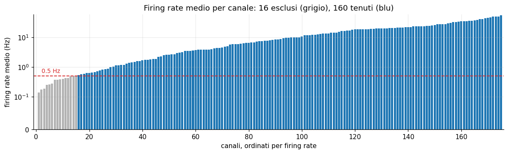 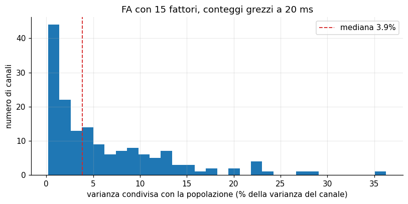 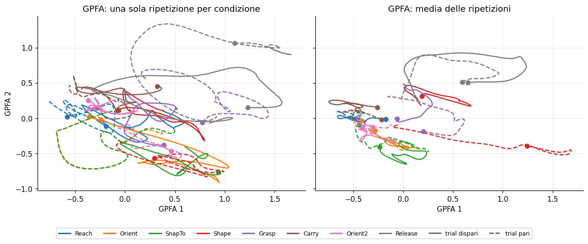 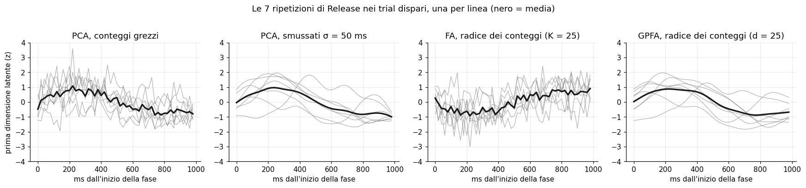 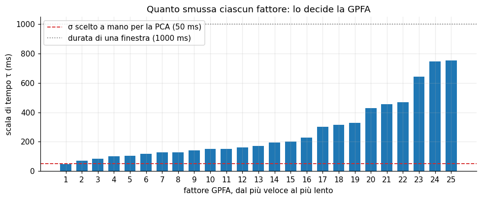 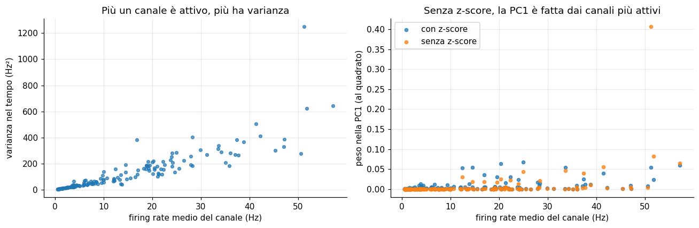 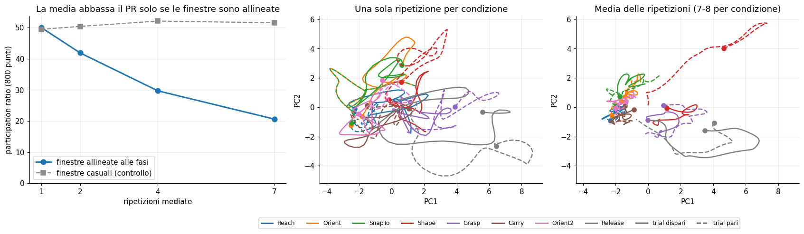 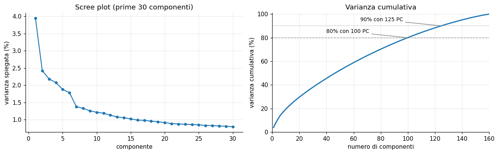 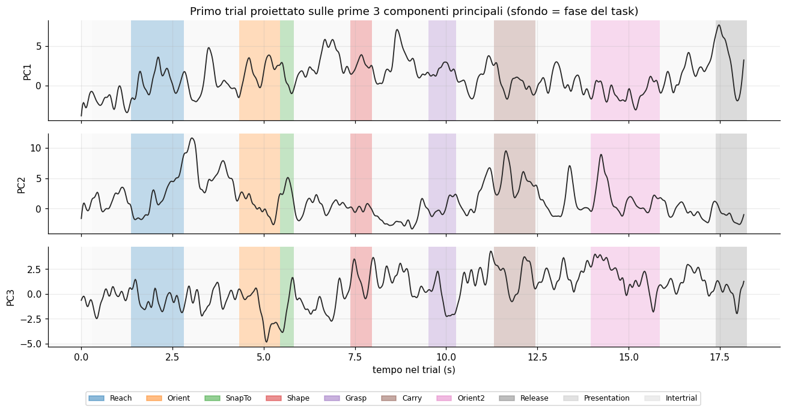 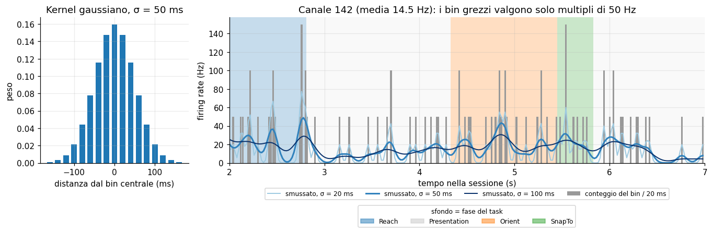 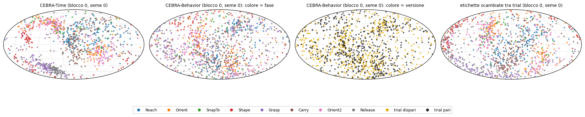 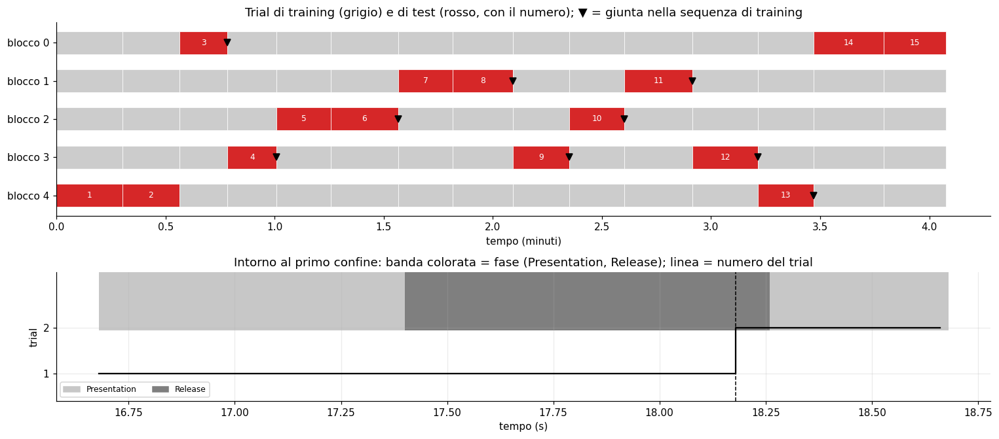 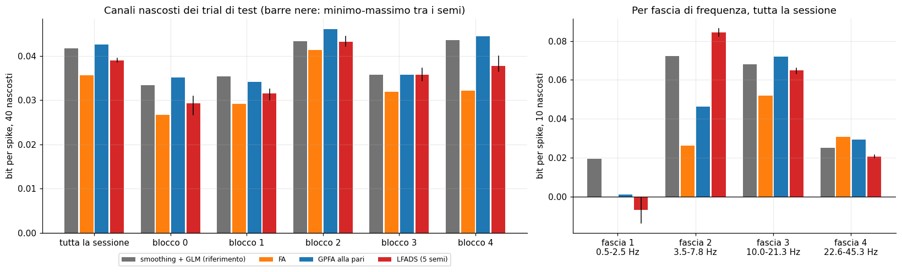 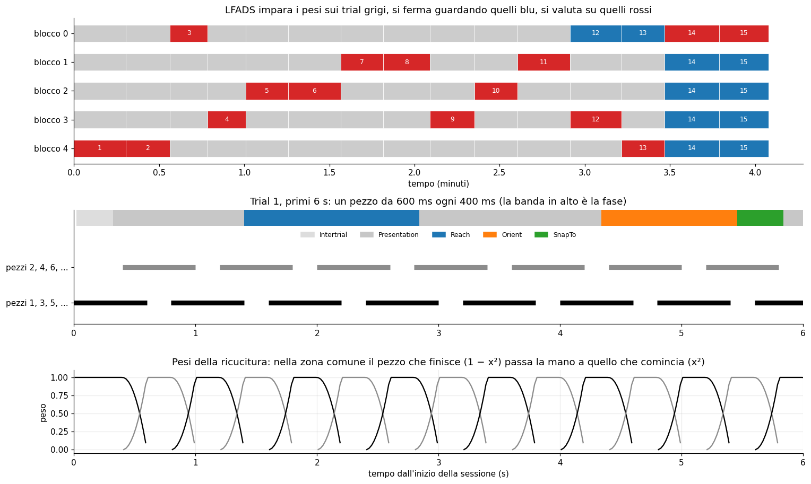 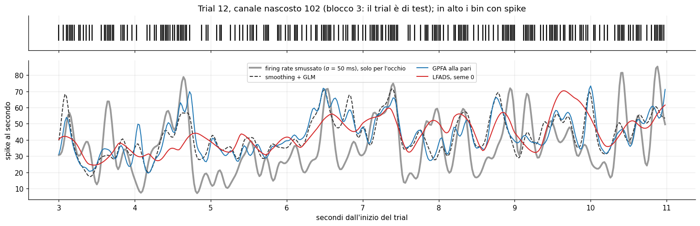 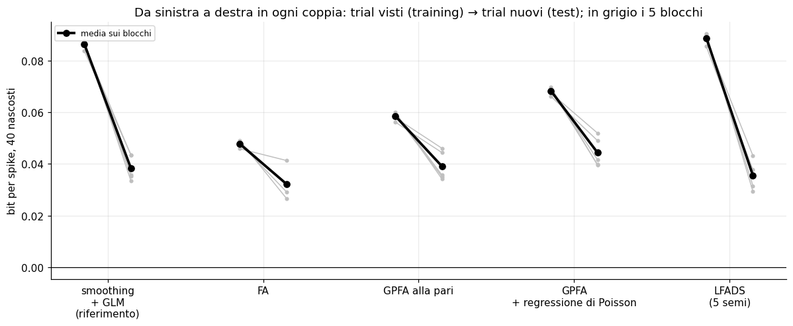 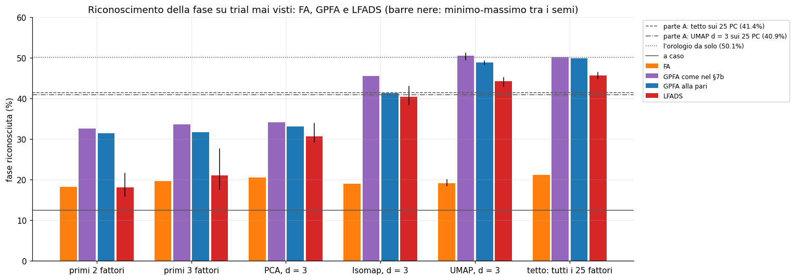 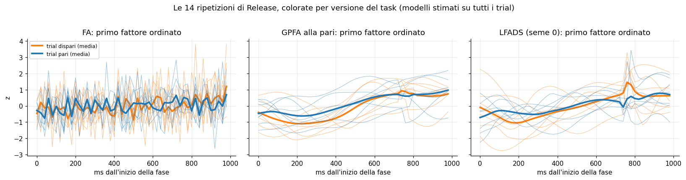 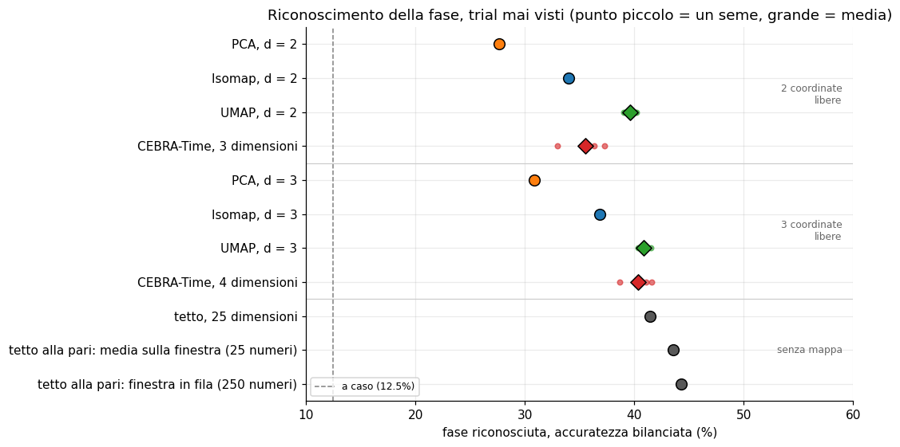 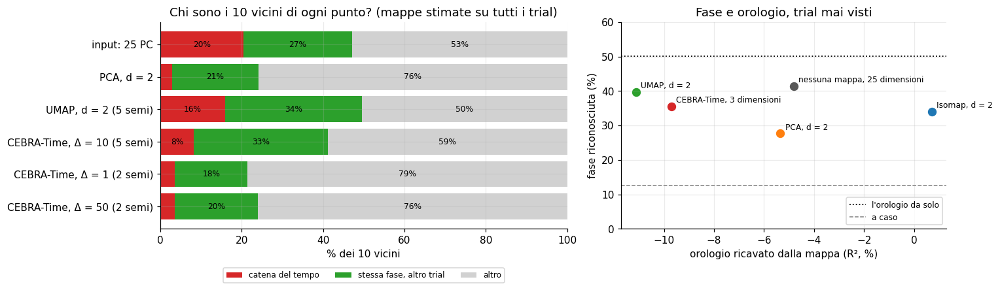 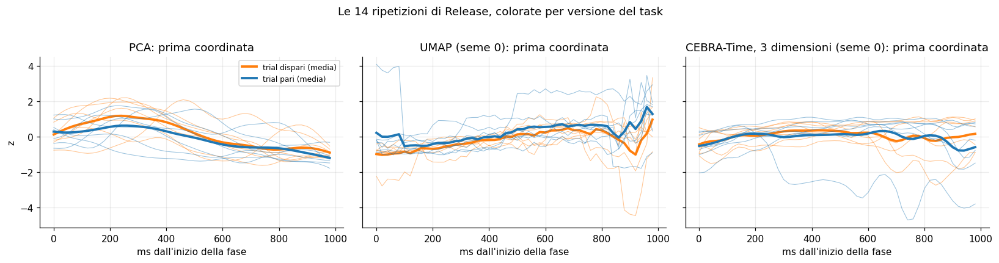 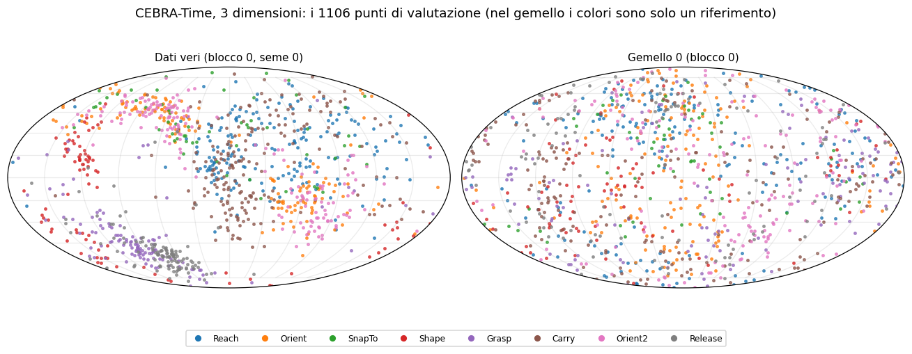 
