# Sessione 19250113T120811 (S2)

Generato da `rep/tabelle.py`. Bin di FALCON.

## Decoder

| condizione | R² medio | tx | ty | tz | rx | g1 | g2 | g3 | α |
|---|---|---|---|---|---|---|---|---|---|
| zero-shot (senza il suo giorno) | 0.097 | 0.209 | -2.820 | -0.430 | 0.162 | -0.071 | 0.059 | 0.336 | 10^4.5 |
| held-in 80% (giorno incluso) | 0.401 | 0.283 | -0.622 | -0.233 | 0.359 | 0.415 | 0.431 | 0.399 | 10^4.5 |
| solo la sessione, 80% | 0.344 | 0.247 | -0.368 | -0.292 | 0.269 | 0.446 | 0.366 | 0.270 | 10^4.5 |

## Dimensionalità e sottospazi (02)

**Dati**

| misura | S2 |
|---|---|
| canali attivi (≥ 0,5 Hz) | 166 |
| frequenza media (Hz) | 14.7 |

**PCA (σ = 50 ms, tutti i bin)**

| misura | S2 |
|---|---|
| participation ratio | 104.0 |
| varianza della PC1 (%) | 4.1 |
| varianza delle PC1-3 (%) | 9.5 |
| componenti per l'80% / 90% / 95% | 103 / 129 / 145 |

**PCA sulle medie per condizione**

| misura | S2 |
|---|---|
| participation ratio | 16.1 |
| componenti per il 95% | 78 |
| PR con 1 / 7 ripetizioni mediate (finestre allineate) | 47.6 / 16.9 |

**FA (conteggi, K* = 15)**

| misura | S2 |
|---|---|
| PR della parte condivisa | 9.4 |
| dimensioni condivise per il 95% | 14 |
| prime 3 direzioni (% della varianza condivisa) | 47 |
| quota condivisa per canale, mediana | 0.034 |

**FA nelle finestre (K* = 10)**

| misura | S2 |
|---|---|
| PR della parte condivisa | 6.6 |

**GPFA (d = 25)**

| misura | S2 |
|---|---|
| PR della parte condivisa | 10.5 |
| dimensioni condivise per il 95% | 21 |
| quota condivisa per canale, mediana (%) | 3.8 |
| scala temporale più breve / più lunga (ms) | 61.0 / 1125.0 |

**Traiettorie nelle finestre**

| misura | S2 |
|---|---|
| consistenza: PCA smussata | 0.1422 |
| consistenza: FA (K = 25) | 0.0448 |
| consistenza: GPFA (d = 25) | 0.1542 |
| seghettatura: GPFA (d = 25) | 0.0044 |

## CEBRA, LFADS, GPFA (04)

**Dati**

| misura | S2 |
|---|---|
| punti di valutazione | 1037 |

**Fase riconosciuta (%), caso 12,5**

| misura | S2 |
|---|---|
| PCA, d = 3 | 37.8 |
| CEBRA-Time, 3 dimensioni | 40.5 (37.7-42.4) |
| CEBRA-Time, 4 dimensioni | 44.0 (41.0-46.9) |
| tetto: 25 PC smussati | 46.7 |
| tetto alla pari: media sulla finestra | 48.0 |
| orologio (solo il tempo dall'inizio del trial) | 47.2 |
| CEBRA-Time 3D sui gemelli | 12.8 (11.6-14.1) |

**CEBRA-Time**

| misura | S2 |
|---|---|
| consistenza tra allenamenti, 3D (R², %) | 65.3 (53.7-84.9) |
| consistenza tra allenamenti, 4D (R², %) | 68.0 (58.4-79.3) |
| vicini nella catena del tempo, Δ = 10 (%) | 8.1 |
| vicini della stessa fase in altri trial, Δ = 10 (%) | 35.7 |
| seghettatura, 4D | 0.072 (0.059-0.077) |
| consistenza delle traiettorie, 4D | 0.113 (0.090-0.128) |

**§12: fase, tetto con tutti i 25 fattori (%)**

| misura | S2 |
|---|---|
| FA | 28.0 |
| GPFA come nel §7b | 53.2 |
| GPFA alla pari | 54.4 |
| LFADS (5 semi) | 52.3 (50.5-53.0) |
| 25 PC smussati (parte A) | 46.7 |

**§12: fase, primi 3 fattori (%)**

| misura | S2 |
|---|---|
| FA | 22.0 |
| GPFA alla pari | 37.9 |
| LFADS (5 semi) | 25.1 (21.8-28.3) |
| 25 PC smussati (parte A) | 37.8 |

**§12: fase senza SnapTo, tetto (%), caso 14,3**

| misura | S2 |
|---|---|
| GPFA alla pari | 62.3 |
| LFADS (5 semi) | 59.7 (58.2-60.6) |

**§12: bit/spike sui 40 canali nascosti, trial nuovi**

| misura | S2 |
|---|---|
| smoothing + GLM (riferimento) | 0.0247 |
| FA | 0.0227 |
| GPFA alla pari | 0.0294 |
| LFADS (5 semi) | 0.0292 [0.0280, 0.0305] |
| GPFA + regressione di Poisson | 0.0339 |
| LFADS sopra lo smoothing + GLM (blocco × seme) | 25 su 25 |

**§13: bit/spike, trial nuovi / trial visti**

| misura | S2 |
|---|---|
| smoothing + GLM | 0.3051 |
| GPFA alla pari | 0.5831 |
| LFADS (5 semi) | 0.3557 [0.3290, 0.3707] |

**§13: bit/spike con canali nascosti spostati nel tempo (trial nuovi)**

| misura | S2 |
|---|---|
| smoothing + GLM | -0.0230 |
| GPFA alla pari | -0.0145 |
| LFADS (3 semi) | -0.0138 [-0.0148, -0.0132] |

**§13: gemelli**

| misura | S2 |
|---|---|
| LFADS sul gemello, fase con tutti i fattori (%) | 12.9 (11.1-14.2) |

**§12: stabilità**

| misura | S2 |
|---|---|
| LFADS tra semi, 25 fattori (R², %) | 89.7 (88.2-91.1) |
| consistenza delle traiettorie: GPFA alla pari | 0.157 |
| consistenza delle traiettorie: LFADS | 0.086 (0.051-0.122) |

## Angoli principali (angolo medio, gradi)

| metodo | rif. S1 – S2 | S2 – S5 | metà – metà S2 | caso dalla covarianza (mediana) |
|---|---|---|---|---|
| PCA, K = 10 | 46.5 | 46.9 | 41.0 | 75.8 |
| PCA, K = 25 | 51.9 | 53.2 | 49.9 | 67.2 |
| FA, K = 10 | 36.4 | 40.0 | 34.4 | 77.3 |
| FA, K = 15 | 42.8 | 45.3 | 41.6 | 74.1 |
| FA, K = 25 | 46.8 | 47.2 | 48.1 | 69.0 |
| GPFA, K = 10 | 49.8 | 50.0 | 42.7 | 75.0 |
| GPFA, K = 25 | 48.4 | 49.8 | 47.6 | 65.4 |

## Figure

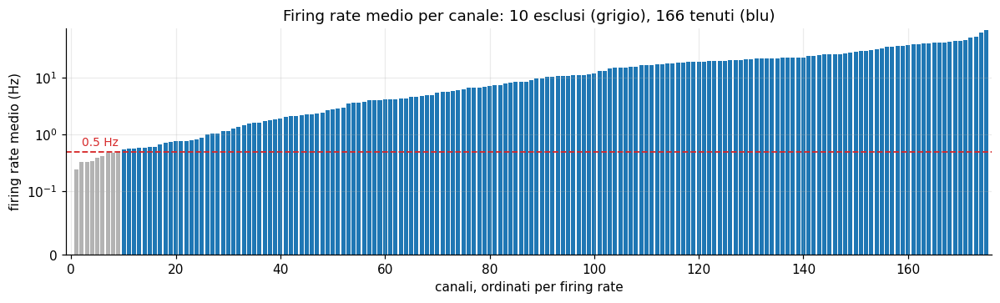 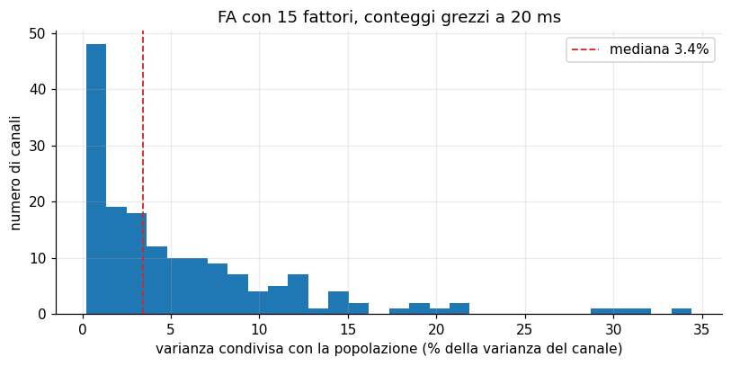 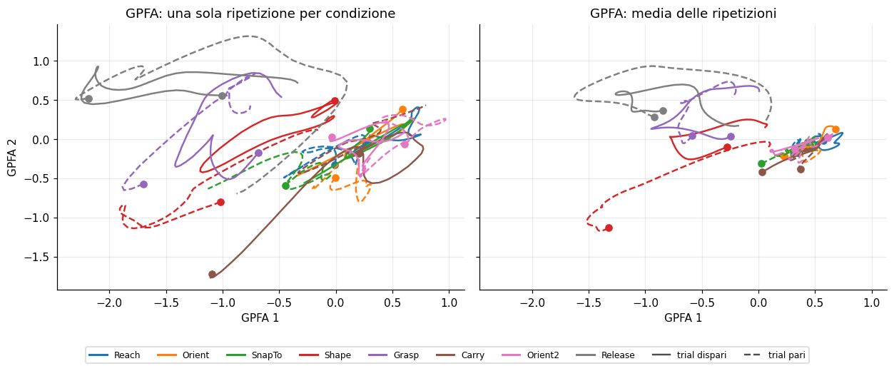 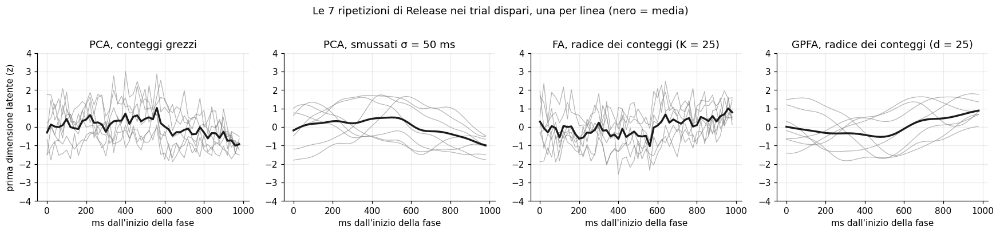 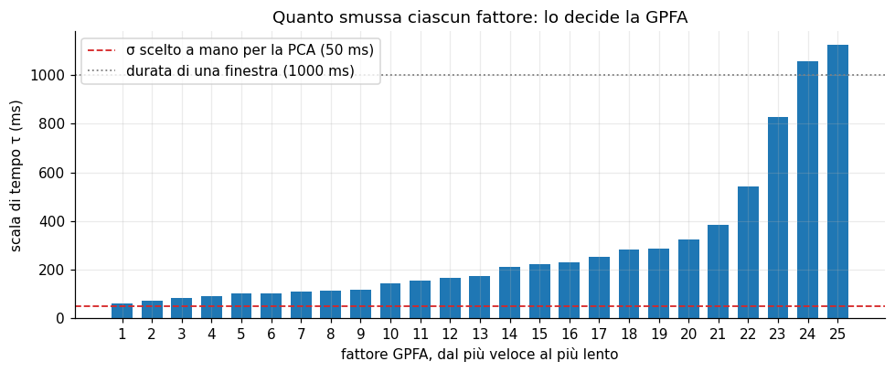 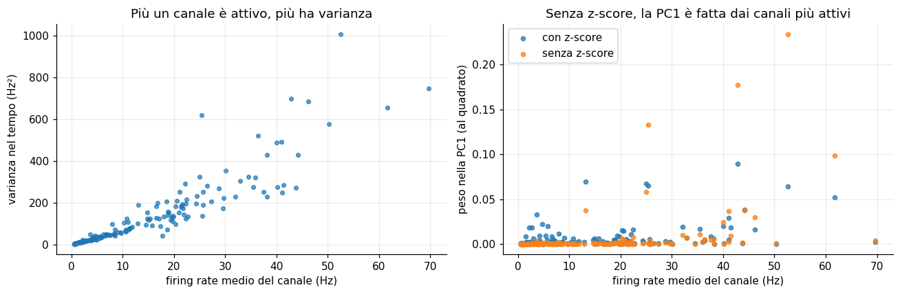 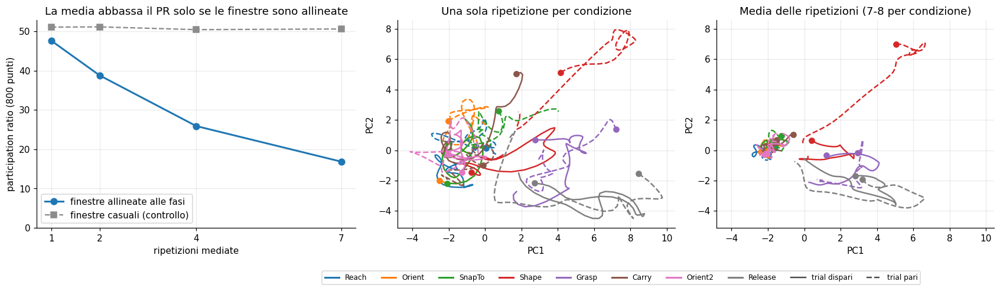 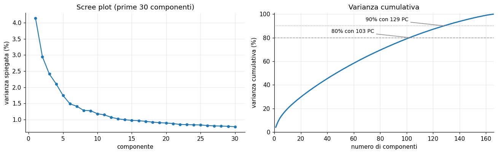 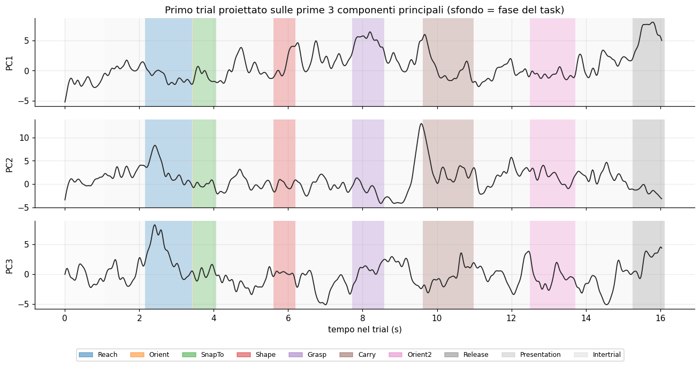 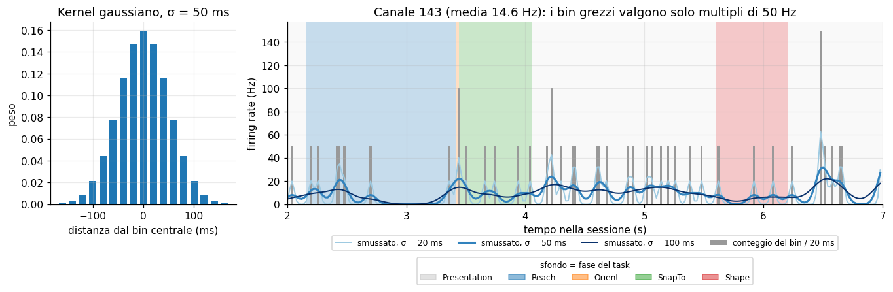 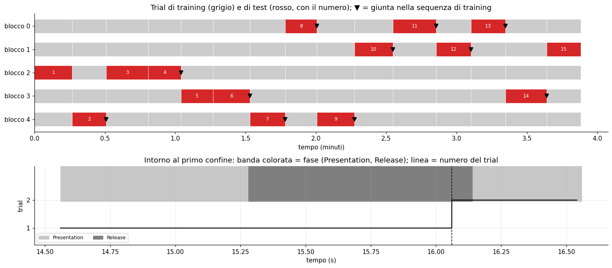 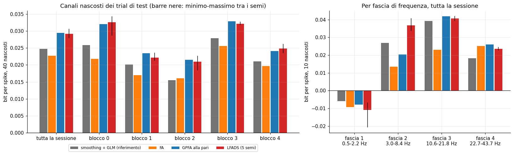 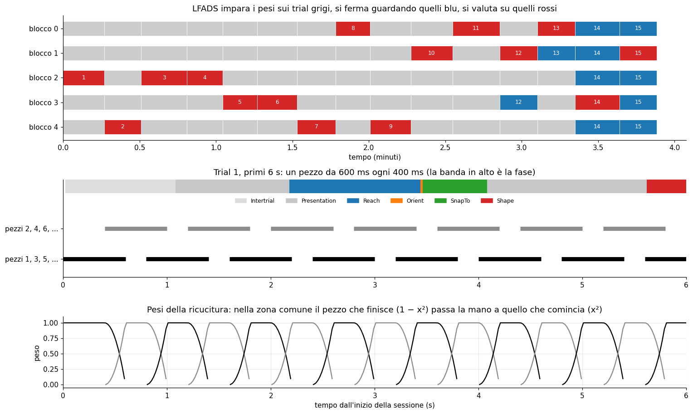 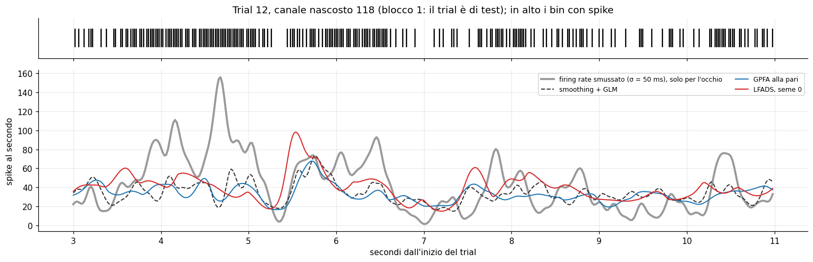 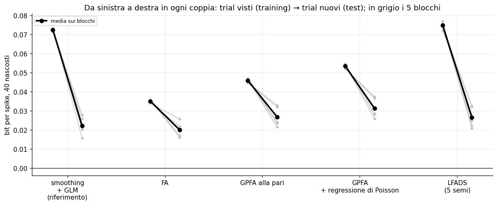 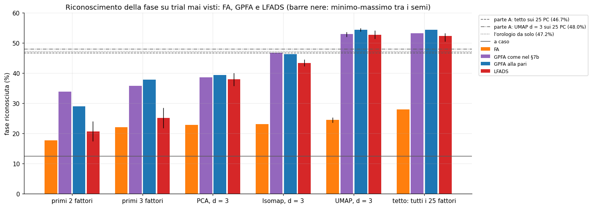 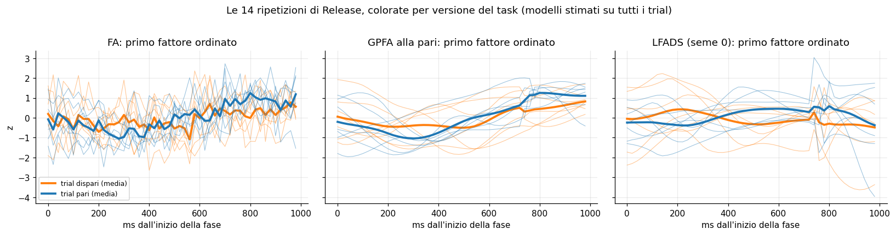 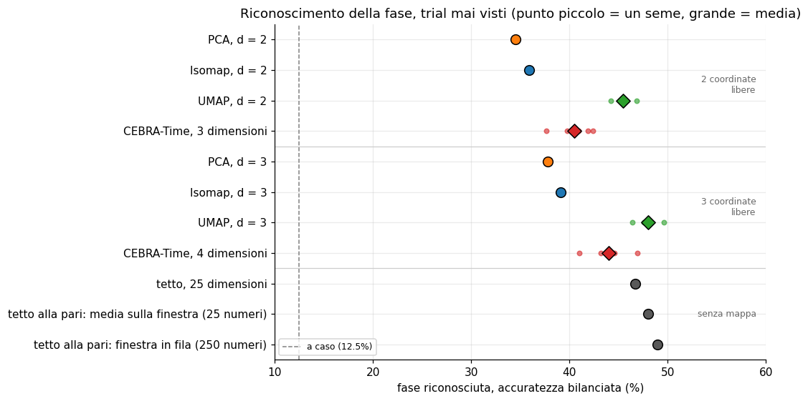 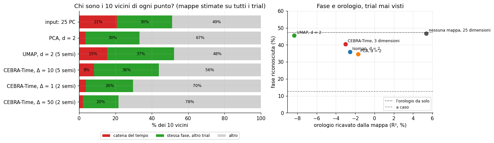 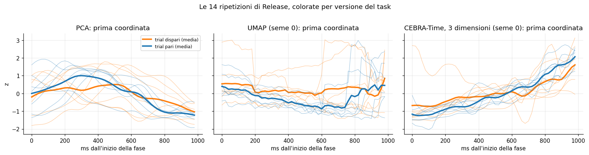 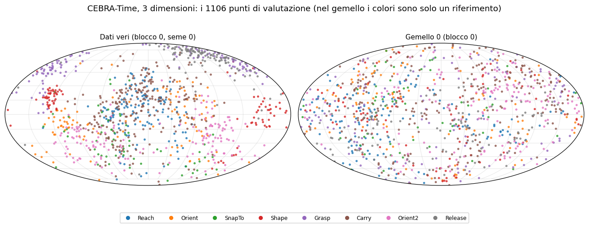 
