# Sessione 19250120T115044 (S5)

Generato da `rep/tabelle.py`. Bin di FALCON.

## Decoder

| condizione | R² medio | tx | ty | tz | rx | g1 | g2 | g3 | α |
|---|---|---|---|---|---|---|---|---|---|
| zero-shot (senza il suo giorno) | 0.192 | 0.237 | -1.059 | -0.309 | 0.462 | 0.329 | 0.344 | -0.281 | 10^4.5 |
| held-in 80% (giorno incluso) | 0.452 | 0.392 | 0.331 | 0.349 | 0.543 | 0.423 | 0.445 | 0.441 | 10^4.5 |
| solo la sessione, 80% | 0.338 | 0.374 | 0.288 | 0.186 | 0.409 | 0.376 | 0.292 | 0.319 | 10^4.5 |

## Dimensionalità e sottospazi (02)

**Dati**

| misura | S5 |
|---|---|
| canali attivi (≥ 0,5 Hz) | 165 |
| frequenza media (Hz) | 16.8 |

**PCA (σ = 50 ms, tutti i bin)**

| misura | S5 |
|---|---|
| participation ratio | 94.4 |
| varianza della PC1 (%) | 4.8 |
| varianza delle PC1-3 (%) | 11.0 |
| componenti per l'80% / 90% / 95% | 100 / 126 / 143 |

**PCA sulle medie per condizione**

| misura | S5 |
|---|---|
| participation ratio | 21.6 |
| componenti per il 95% | 79 |
| PR con 1 / 7 ripetizioni mediate (finestre allineate) | 48.5 / 22.6 |

**FA (conteggi, K* = 15)**

| misura | S5 |
|---|---|
| PR della parte condivisa | 9.1 |
| dimensioni condivise per il 95% | 14 |
| prime 3 direzioni (% della varianza condivisa) | 48 |
| quota condivisa per canale, mediana | 0.032 |

**FA nelle finestre (K* = 10)**

| misura | S5 |
|---|---|
| PR della parte condivisa | 6.9 |

**GPFA (d = 25)**

| misura | S5 |
|---|---|
| PR della parte condivisa | 11.6 |
| dimensioni condivise per il 95% | 21 |
| quota condivisa per canale, mediana (%) | 3.9 |
| scala temporale più breve / più lunga (ms) | 51.0 / 1268.0 |

**Traiettorie nelle finestre**

| misura | S5 |
|---|---|
| consistenza: PCA smussata | 0.1533 |
| consistenza: FA (K = 25) | 0.0577 |
| consistenza: GPFA (d = 25) | 0.1549 |
| seghettatura: GPFA (d = 25) | 0.0049 |

## CEBRA, LFADS, GPFA (04)

**Dati**

| misura | S5 |
|---|---|
| punti di valutazione | 1137 |

**Fase riconosciuta (%), caso 12,5**

| misura | S5 |
|---|---|
| PCA, d = 3 | 28.3 |
| CEBRA-Time, 3 dimensioni | 31.2 (29.6-33.0) |
| CEBRA-Time, 4 dimensioni | 34.9 (33.3-37.0) |
| tetto: 25 PC smussati | 36.9 |
| tetto alla pari: media sulla finestra | 39.7 |
| orologio (solo il tempo dall'inizio del trial) | 63.8 |
| CEBRA-Time 3D sui gemelli | 14.1 (12.7-16.3) |

**CEBRA-Time**

| misura | S5 |
|---|---|
| consistenza tra allenamenti, 3D (R², %) | 64.5 (51.3-81.5) |
| consistenza tra allenamenti, 4D (R², %) | 75.2 (64.6-85.2) |
| vicini nella catena del tempo, Δ = 10 (%) | 8.4 |
| vicini della stessa fase in altri trial, Δ = 10 (%) | 25.1 |
| seghettatura, 4D | 0.077 (0.072-0.084) |
| consistenza delle traiettorie, 4D | 0.091 (0.086-0.097) |

**§12: fase, tetto con tutti i 25 fattori (%)**

| misura | S5 |
|---|---|
| FA | 22.4 |
| GPFA come nel §7b | 42.6 |
| GPFA alla pari | 42.6 |
| LFADS (5 semi) | 42.5 (39.7-45.2) |
| 25 PC smussati (parte A) | 36.9 |

**§12: fase, primi 3 fattori (%)**

| misura | S5 |
|---|---|
| FA | 19.8 |
| GPFA alla pari | 26.2 |
| LFADS (5 semi) | 19.6 (15.8-23.9) |
| 25 PC smussati (parte A) | 28.3 |

**§12: fase senza SnapTo, tetto (%), caso 14,3**

| misura | S5 |
|---|---|
| GPFA alla pari | 49.0 |
| LFADS (5 semi) | 47.5 (45.3-50.8) |

**§12: bit/spike sui 40 canali nascosti, trial nuovi**

| misura | S5 |
|---|---|
| smoothing + GLM (riferimento) | 0.0563 |
| FA | 0.0368 |
| GPFA alla pari | 0.0602 |
| LFADS (5 semi) | 0.0575 [0.0572, 0.0579] |
| GPFA + regressione di Poisson | 0.0642 |
| LFADS sopra lo smoothing + GLM (blocco × seme) | 20 su 25 |

**§13: bit/spike, trial nuovi / trial visti**

| misura | S5 |
|---|---|
| smoothing + GLM | 0.5301 |
| GPFA alla pari | 0.7424 |
| LFADS (5 semi) | 0.5214 [0.5167, 0.5260] |

**§13: bit/spike con canali nascosti spostati nel tempo (trial nuovi)**

| misura | S5 |
|---|---|
| smoothing + GLM | -0.0229 |
| GPFA alla pari | -0.0199 |
| LFADS (3 semi) | -0.0169 [-0.0171, -0.0166] |

**§13: gemelli**

| misura | S5 |
|---|---|
| LFADS sul gemello, fase con tutti i fattori (%) | 13.3 (10.9-15.8) |

**§12: stabilità**

| misura | S5 |
|---|---|
| LFADS tra semi, 25 fattori (R², %) | 90.3 (89.1-91.5) |
| consistenza delle traiettorie: GPFA alla pari | 0.153 |
| consistenza delle traiettorie: LFADS | 0.091 (0.056-0.132) |

## Angoli principali (angolo medio, gradi)

Sottospazi stimati su tutti i bin; casi: mediana e 5° percentile dell'angolo medio su 500 coppie (vedi confronto.md, §4).

| metodo | confronto | osservato | caso, tutti i bin: mediana (5°) | sotto il 5° (caso, tutti i bin) | caso, medie per condizione: mediana (5°) | sotto il 5° (caso, medie per condizione) | uniforme: mediana (5°) | sotto il 5° (uniforme) |
|---|---|---|---|---|---|---|---|---|
| PCA, K = 10 | rif. S1 – S5 | 50.7 | 75.6 (73.7) | sì | 68.4 (66.0) | sì | 77.5 (76.0) | sì |
| PCA, K = 10 | S2 – S5 | 46.9 | 75.5 (73.5) | sì | 68.2 (65.7) | sì | 77.5 (76.0) | sì |
| PCA, K = 10 | metà – metà S5 | 37.3 | 74.7 (72.7) | sì | 65.6 (63.0) | sì | 77.5 (76.0) | sì |
| PCA, K = 25 | rif. S1 – S5 | 55.5 | 67.1 (66.0) | sì | 59.4 (58.0) | sì | 69.3 (68.4) | sì |
| PCA, K = 25 | S2 – S5 | 53.2 | 66.9 (65.8) | sì | 59.3 (57.9) | sì | 69.3 (68.4) | sì |
| PCA, K = 25 | metà – metà S5 | 49.4 | 66.2 (65.0) | sì | 55.0 (53.5) | sì | 69.3 (68.4) | sì |
| FA, K = 10 | rif. S1 – S5 | 38.9 | 77.3 (75.6) | sì | 75.6 (73.7) | sì | 77.5 (76.0) | sì |
| FA, K = 10 | S2 – S5 | 40.0 | 77.3 (75.6) | sì | 75.4 (73.5) | sì | 77.5 (76.0) | sì |
| FA, K = 10 | metà – metà S5 | 36.8 | 77.2 (75.5) | sì | 74.9 (72.9) | sì | 77.5 (76.0) | sì |
| FA, K = 15 | rif. S1 – S5 | 42.8 | 74.1 (72.8) | sì | 72.3 (70.9) | sì | 74.4 (73.2) | sì |
| FA, K = 15 | S2 – S5 | 45.3 | 74.1 (72.8) | sì | 72.2 (70.7) | sì | 74.4 (73.2) | sì |
| FA, K = 15 | metà – metà S5 | 39.0 | 74.0 (72.7) | sì | 71.6 (70.1) | sì | 74.4 (73.2) | sì |
| FA, K = 25 | rif. S1 – S5 | 47.8 | 69.0 (68.0) | sì | 67.2 (66.2) | sì | 69.3 (68.4) | sì |
| FA, K = 25 | S2 – S5 | 47.2 | 69.0 (68.0) | sì | 67.2 (66.1) | sì | 69.3 (68.4) | sì |
| FA, K = 25 | metà – metà S5 | 46.3 | 68.8 (67.8) | sì | 66.3 (65.2) | sì | 69.3 (68.4) | sì |
| GPFA, K = 10 | rif. S1 – S5 | 49.8 | 74.9 (73.0) | sì | 73.2 (71.1) | sì | 77.5 (76.0) | sì |
| GPFA, K = 10 | S2 – S5 | 50.0 | 74.9 (72.9) | sì | 73.0 (70.9) | sì | 77.5 (76.0) | sì |
| GPFA, K = 10 | metà – metà S5 | 41.8 | 74.6 (72.5) | sì | 72.4 (70.1) | sì | 77.5 (76.0) | sì |
| GPFA, K = 25 | rif. S1 – S5 | 49.7 | 65.4 (64.2) | sì | 63.7 (62.5) | sì | 69.3 (68.4) | sì |
| GPFA, K = 25 | S2 – S5 | 49.8 | 65.3 (64.1) | sì | 63.6 (62.4) | sì | 69.3 (68.4) | sì |
| GPFA, K = 25 | metà – metà S5 | 46.2 | 64.8 (63.6) | sì | 62.5 (61.3) | sì | 69.3 (68.4) | sì |

## Figure

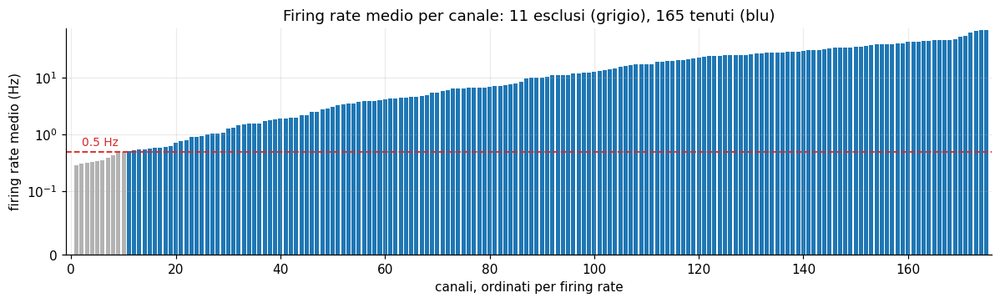 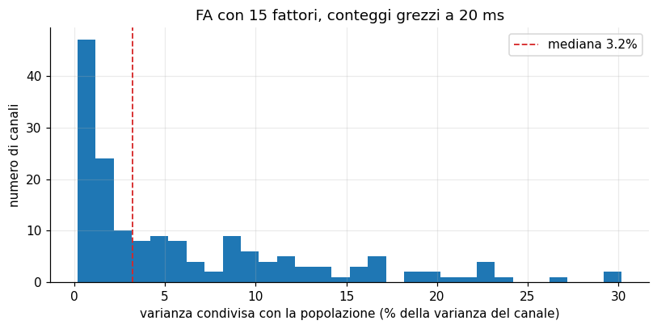 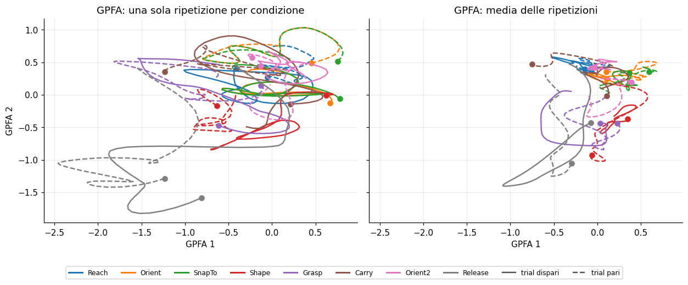 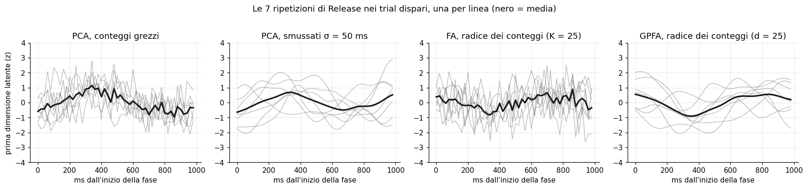 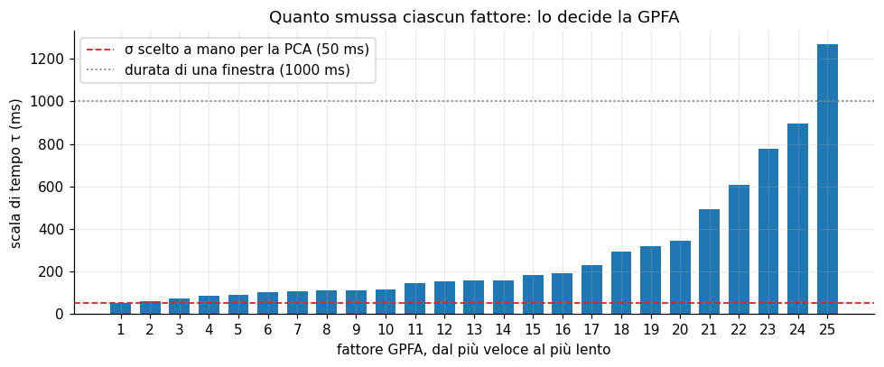 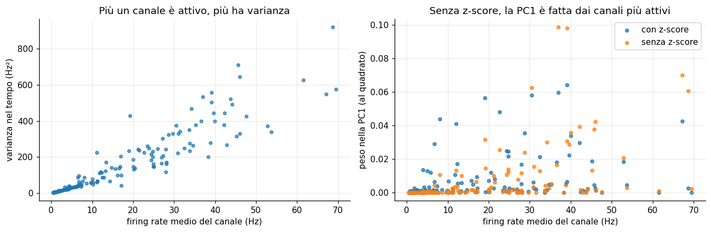 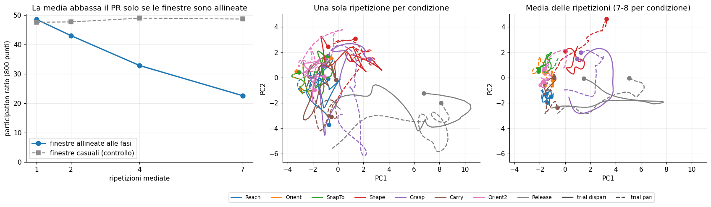 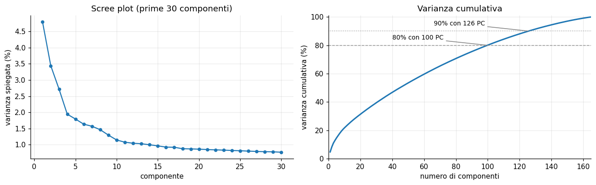 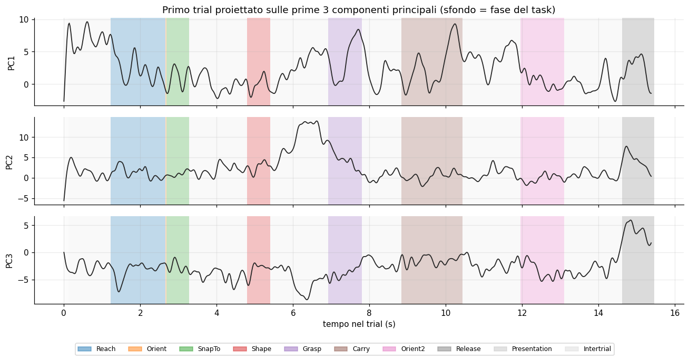 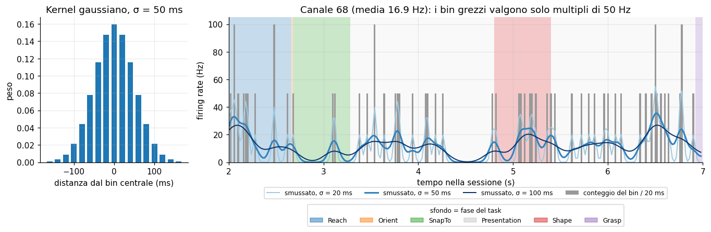 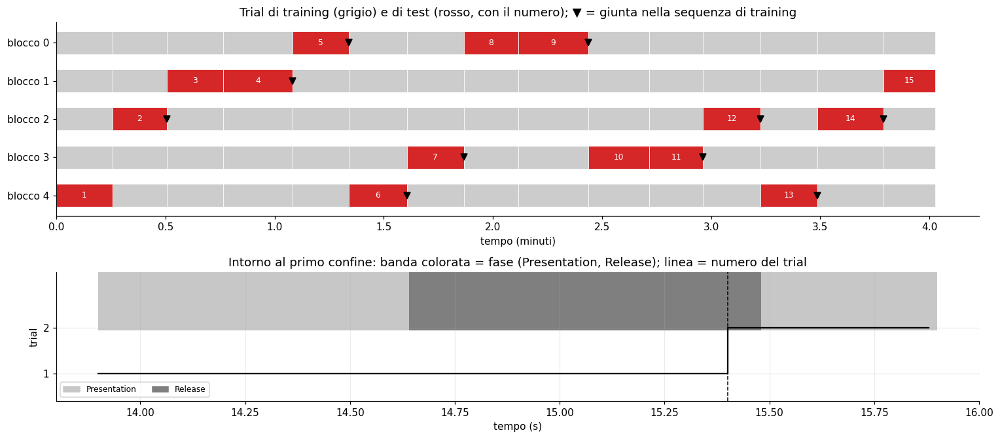 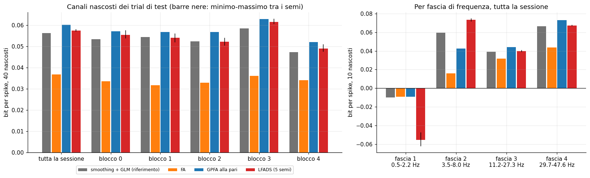 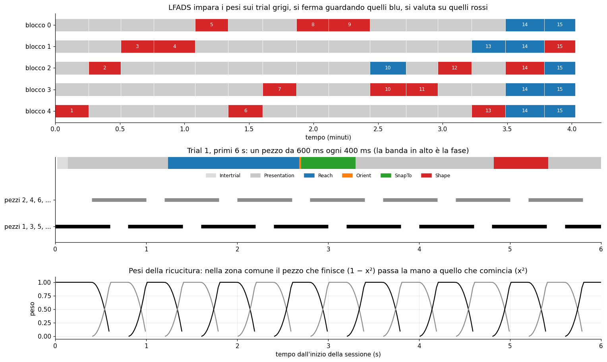 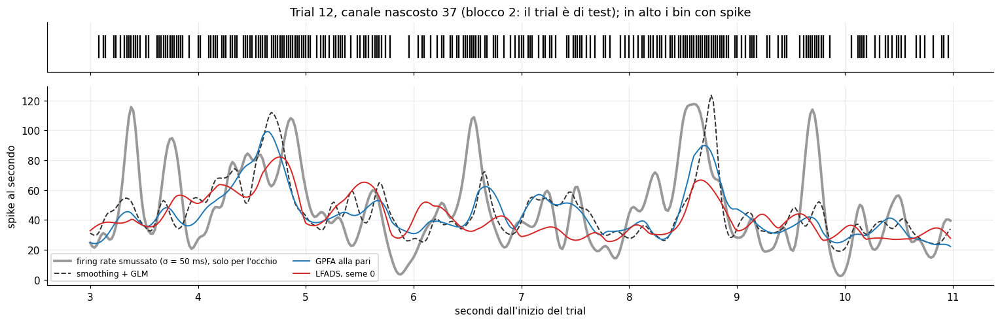 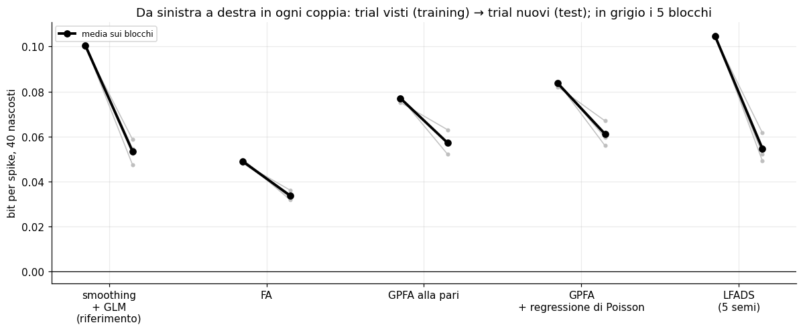 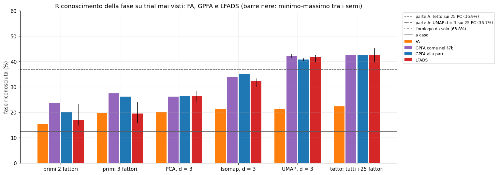 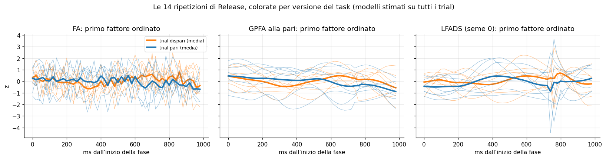 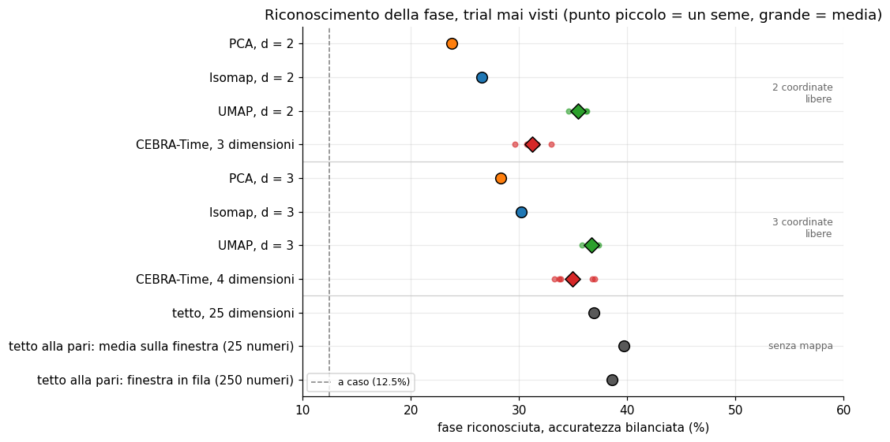 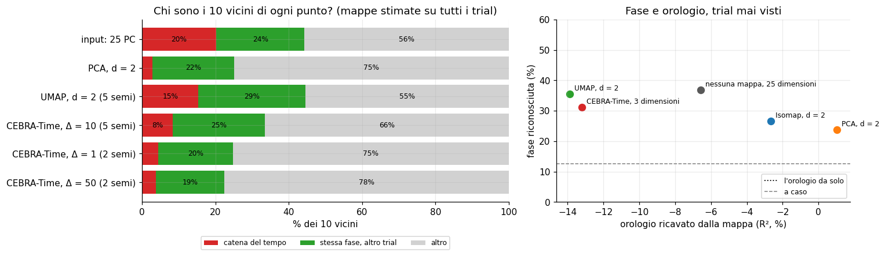 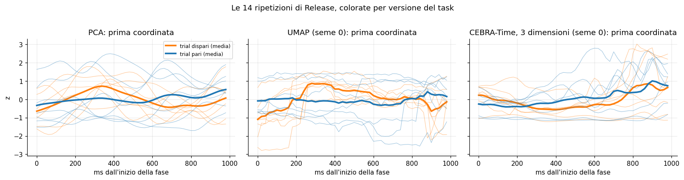 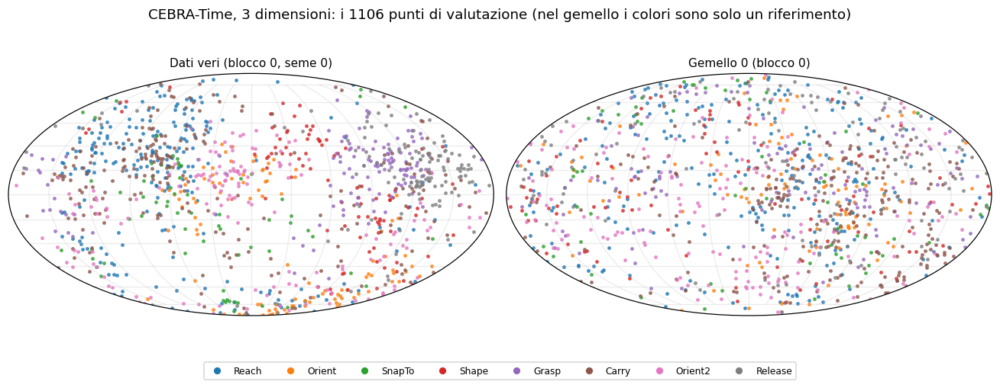 
