# Session 19250108T110520 (ref. S1)

Generated by `rep/tables.py`. FALCON bins, with the numbers of the original notebooks (io.py bins) alongside.

## Decoder

| condition | mean R² | tx | ty | tz | rx | g1 | g2 | g3 | α |
|---|---|---|---|---|---|---|---|---|---|
| zero-shot (without its own day) | 0.174 | 0.114 | -0.427 | -0.213 | 0.068 | 0.149 | 0.196 | 0.264 | 10^4.5 |
| held-in 80% (day included) | 0.305 | 0.210 | -0.512 | 0.299 | 0.331 | 0.307 | 0.311 | 0.293 | 10^4.5 |
| session only, 80% | 0.291 | -0.111 | -0.572 | 0.392 | 0.240 | 0.378 | 0.351 | 0.170 | 10^4.0 |

## Dimensionality and subspaces (02)

**Data**

| measure | ref. S1 | original (io.py) |
|---|---|---|
| active channels (≥ 0.5 Hz) | 160 | 160 |
| mean rate (Hz) | 14.2 | 14.2 |

**PCA (σ = 50 ms, all bins)**

| measure | ref. S1 | original (io.py) |
|---|---|---|
| participation ratio | 106.1 | 106.1 |
| variance of PC1 (%) | 3.9 | 3.9 |
| variance of PC1-3 (%) | 8.6 | 8.5 |
| components for 80% / 90% / 95% | 100 / 125 / 140 | 100 / 125 / 140 |

**PCA on condition means**

| measure | ref. S1 | original (io.py) |
|---|---|---|
| participation ratio | 19.7 | 19.7 |
| components for 95% | 78 | 78 |
| PR with 1 / 7 repetitions averaged (aligned windows) | 50.1 / 20.6 | 50.1 / 20.6 |

**FA (counts, K* = 15)**

| measure | ref. S1 | original (io.py) |
|---|---|---|
| PR of the shared part | 9.5 | 9.5 |
| shared dimensions for 95% | 14 | 14 |
| first 3 directions (% of shared variance) | 46 | 46 |
| shared fraction per channel, median | 0.039 | 0.038 |

**FA in windows (K* = 10)**

| measure | ref. S1 | original (io.py) |
|---|---|---|
| PR of the shared part | 7.0 | 7.0 |

**GPFA (d = 25)**

| measure | ref. S1 | original (io.py) |
|---|---|---|
| PR of the shared part | 12.2 | 12.2 |
| shared dimensions for 95% | 21 | 21 |
| shared fraction per channel, median (%) | 3.2 | 3.2 |
| shortest / longest timescale (ms) | 48.0 / 754.0 | 48.0 / 754.0 |

**Trajectories in windows**

| measure | ref. S1 | original (io.py) |
|---|---|---|
| consistency: smoothed PCA | 0.1167 | 0.1167 |
| consistency: FA (K = 25) | 0.0387 | 0.0387 |
| consistency: GPFA (d = 25) | 0.1369 | 0.1369 |
| roughness: GPFA (d = 25) | 0.0108 | 0.0108 |

## CEBRA, LFADS, GPFA (04)

**Data**

| measure | ref. S1 | original (io.py) |
|---|---|---|
| evaluation points | 1099 | 1106 |

**Decoded phase (%), chance 12.5**

| measure | ref. S1 | original (io.py) |
|---|---|---|
| PCA, d = 3 | 30.9 | 32.4 |
| CEBRA-Time, 3 dimensions | 35.5 (33.0-37.3) | 37.7 (35.3-40.6) |
| CEBRA-Time, 4 dimensions | 40.3 (38.7-41.6) | 40.4 (38.5-42.7) |
| ceiling: 25 smoothed PCs | 41.4 | 42.2 |
| matched ceiling: window mean | 43.6 | 44.9 |
| clock (only the time since trial start) | 50.1 | 48.5 |
| CEBRA-Time 3D on the twins | 13.1 (12.3-13.9) | 12.5 (10.7-13.9) |

**CEBRA-Time**

| measure | ref. S1 | original (io.py) |
|---|---|---|
| consistency across training runs, 3D (R², %) | 66.0 (51.3-83.0) | 63.4 (46.9-83.1) |
| consistency across training runs, 4D (R², %) | 75.9 (67.1-84.1) | 75.1 (66.8-83.9) |
| neighbors in the time chain, Δ = 10 (%) | 8.2 | 7.9 |
| same-phase neighbors in other trials, Δ = 10 (%) | 32.9 | 33.1 |
| roughness, 4D | 0.074 (0.065-0.082) | 0.074 (0.066-0.080) |
| trajectory consistency, 4D | 0.106 (0.088-0.129) | 0.106 (0.086-0.127) |

**§6, ref. only: phase (%)**

| measure | ref. S1 | original (io.py) |
|---|---|---|
| CEBRA-Behavior, 3 dimensions | 23.8 (21.5-25.8) | 25.6 (22.4-27.9) |
| CEBRA-Behavior, 4 dimensions | 30.3 (28.3-32.4) | 28.7 (27.3-30.1) |
| PLS, 2 components | 26.8 | 27.3 |
| PLS, 3 components | 29.5 | 28.3 |
| gap CEBRA-Time − CEBRA-Behavior, 3D / 4D (points) | 11.7 / 10.0 | 12.1 / 11.7 |
| CEBRA-Behavior 3D, labels shuffled in time | 15.1 (13.4-16.3) | 15.1 (12.9-17.3) |
| CEBRA-Behavior 3D, labels swapped between trials | 29.2 (27.7-30.7) | 29.8 (28.1-31.3) |

**§6, ref. only: kin_r2, velocity (R², %)**

| measure | ref. S1 | original (io.py) |
|---|---|---|
| CEBRA-Time, 4 dimensions | 5.1 (3.6-6.3) | 1.5 (-1.1-3.8) |
| CEBRA-Behavior, 4 dimensions | -0.6 (-3.0-1.4) | -1.1 (-5.4-1.2) |
| PLS, 3 components | 7.3 | 4.6 |
| ceiling, 25 dimensions | 20.5 | 19.4 |

**§6, ref. only: kin_r2, position (R², %)**

| measure | ref. S1 | original (io.py) |
|---|---|---|
| CEBRA-Time, 4 dimensions | -33.0 (-34.0--31.8) | -27.8 (-29.3--26.4) |
| CEBRA-Behavior, 4 dimensions | -26.9 (-28.3--25.7) | -23.1 (-24.8--21.9) |
| PLS, 3 components | -23.2 | -19.3 |
| ceiling, 25 dimensions | -23.7 | -16.1 |

**§12: phase, ceiling with all 25 factors (%)**

| measure | ref. S1 | original (io.py) |
|---|---|---|
| FA | 21.2 | 25.8 |
| GPFA as in §7b | 50.2 | 50.7 |
| matched GPFA | 49.9 | 51.4 |
| LFADS (5 seeds) | 45.7 (44.9-46.4) | 46.5 (44.7-47.7) |
| 25 smoothed PCs (part A) | 41.4 | 42.2 |

**§12: phase, first 3 factors (%)**

| measure | ref. S1 | original (io.py) |
|---|---|---|
| FA | 19.7 | 17.3 |
| matched GPFA | 31.7 | 30.9 |
| LFADS (5 seeds) | 21.1 (17.6-27.6) | 20.9 (19.1-22.4) |
| 25 smoothed PCs (part A) | 30.9 | 32.4 |

**§12: phase without SnapTo, ceiling (%), chance 14.3**

| measure | ref. S1 | original (io.py) |
|---|---|---|
| matched GPFA | 56.9 | 58.5 |
| LFADS (5 seeds) | 52.2 (50.6-53.1) | 53.1 (50.6-54.1) |

**§12: bits/spike on the 40 hidden channels, new trials**

| measure | ref. S1 | original (io.py) |
|---|---|---|
| smoothing + GLM (reference) | 0.0417 | 0.0416 |
| FA | 0.0357 | 0.0358 |
| matched GPFA | 0.0426 | 0.0422 |
| LFADS (5 seeds) | 0.0389 [0.0386, 0.0395] | 0.0388 [0.0383, 0.0393] |
| GPFA + Poisson regression | 0.0479 | 0.0474 |
| LFADS above smoothing + GLM (block × seed) | 5 of 25 | 4 of 25 |

**§13: bits/spike, new trials / seen trials**

| measure | ref. S1 | original (io.py) |
|---|---|---|
| smoothing + GLM | 0.4425 | 0.4430 |
| matched GPFA | 0.6673 | 0.6638 |
| LFADS (5 seeds) | 0.3995 [0.3921, 0.4079] | 0.4021 [0.3929, 0.4136] |

**§13: bits/spike with hidden channels shifted in time (new trials)**

| measure | ref. S1 | original (io.py) |
|---|---|---|
| smoothing + GLM | -0.0236 | -0.0234 |
| matched GPFA | -0.0135 | -0.0122 |
| LFADS (3 seeds) | -0.0177 [-0.0183, -0.0173] | -0.0179 [-0.0190, -0.0162] |

**§13: twins**

| measure | ref. S1 | original (io.py) |
|---|---|---|
| LFADS on the twin, phase with all factors (%) | 11.9 (11.2-12.8) | 11.0 (7.8-13.9) |

**§12: stability**

| measure | ref. S1 | original (io.py) |
|---|---|---|
| LFADS across seeds, 25 factors (R², %) | 88.4 (86.1-90.0) | 88.7 (86.7-89.5) |
| trajectory consistency: matched GPFA | 0.114 | 0.118 |
| trajectory consistency: LFADS | 0.130 (0.095-0.184) | 0.109 (0.090-0.135) |

## Principal angles (mean angle, degrees)

Subspaces estimated on all bins; chance cases: median and 5th percentile of the mean angle over 500 pairs (see comparison.md, §4).

| method | comparison | observed | chance, all bins: median (5th) | below 5th (chance, all bins) | chance, condition means: median (5th) | below 5th (chance, condition means) | uniform: median (5th) | below 5th (uniform) |
|---|---|---|---|---|---|---|---|---|
| PCA, K = 10 | ref. S1 – S2 | 46.5 | 75.7 (73.9) | yes | 67.9 (65.3) | yes | 77.5 (76.0) | yes |
| PCA, K = 10 | ref. S1 – S5 | 50.7 | 75.6 (73.7) | yes | 68.4 (66.0) | yes | 77.5 (76.0) | yes |
| PCA, K = 10 | half – half ref. S1 | 43.7 | 75.4 (73.4) | yes | 65.1 (62.5) | yes | 77.5 (76.0) | yes |
| PCA, K = 25 | ref. S1 – S2 | 51.9 | 67.2 (66.1) | yes | 59.1 (57.8) | yes | 69.3 (68.4) | yes |
| PCA, K = 25 | ref. S1 – S5 | 55.5 | 67.1 (66.0) | yes | 59.4 (58.0) | yes | 69.3 (68.4) | yes |
| PCA, K = 25 | half – half ref. S1 | 50.8 | 66.7 (65.6) | yes | 54.9 (53.4) | yes | 69.3 (68.4) | yes |
| FA, K = 10 | ref. S1 – S2 | 36.4 | 77.3 (75.6) | yes | 75.4 (73.5) | yes | 77.5 (76.0) | yes |
| FA, K = 10 | ref. S1 – S5 | 38.9 | 77.3 (75.6) | yes | 75.6 (73.7) | yes | 77.5 (76.0) | yes |
| FA, K = 10 | half – half ref. S1 | 32.8 | 77.2 (75.5) | yes | 74.9 (72.9) | yes | 77.5 (76.0) | yes |
| FA, K = 15 | ref. S1 – S2 | 42.8 | 74.1 (72.8) | yes | 72.1 (70.7) | yes | 74.4 (73.2) | yes |
| FA, K = 15 | ref. S1 – S5 | 42.8 | 74.1 (72.8) | yes | 72.3 (70.9) | yes | 74.4 (73.2) | yes |
| FA, K = 15 | half – half ref. S1 | 40.4 | 74.0 (72.7) | yes | 71.5 (70.1) | yes | 74.4 (73.2) | yes |
| FA, K = 25 | ref. S1 – S2 | 46.8 | 69.0 (68.0) | yes | 67.1 (66.0) | yes | 69.3 (68.4) | yes |
| FA, K = 25 | ref. S1 – S5 | 47.8 | 69.0 (68.0) | yes | 67.2 (66.2) | yes | 69.3 (68.4) | yes |
| FA, K = 25 | half – half ref. S1 | 46.3 | 68.9 (67.9) | yes | 66.3 (65.2) | yes | 69.3 (68.4) | yes |
| GPFA, K = 10 | ref. S1 – S2 | 49.8 | 74.9 (73.0) | yes | 73.0 (70.8) | yes | 77.5 (76.0) | yes |
| GPFA, K = 10 | ref. S1 – S5 | 49.8 | 74.9 (73.0) | yes | 73.2 (71.1) | yes | 77.5 (76.0) | yes |
| GPFA, K = 10 | half – half ref. S1 | 42.9 | 74.5 (72.5) | yes | 72.2 (70.0) | yes | 77.5 (76.0) | yes |
| GPFA, K = 25 | ref. S1 – S2 | 48.4 | 65.4 (64.2) | yes | 63.7 (62.5) | yes | 69.3 (68.4) | yes |
| GPFA, K = 25 | ref. S1 – S5 | 49.7 | 65.4 (64.2) | yes | 63.7 (62.5) | yes | 69.3 (68.4) | yes |
| GPFA, K = 25 | half – half ref. S1 | 45.1 | 64.8 (63.5) | yes | 62.4 (61.2) | yes | 69.3 (68.4) | yes |

## Figures

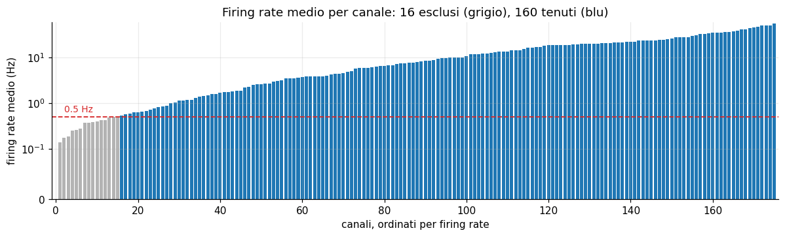 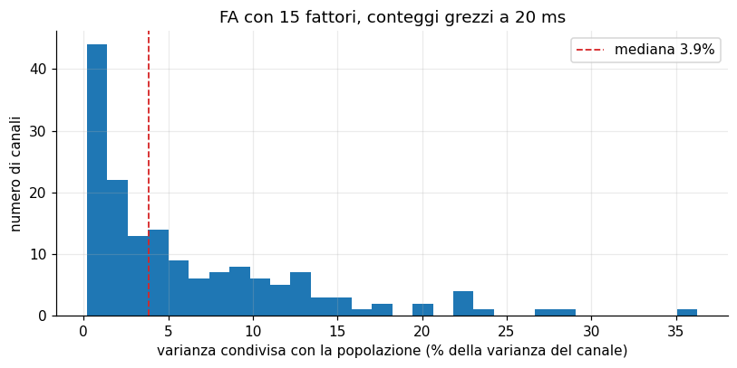 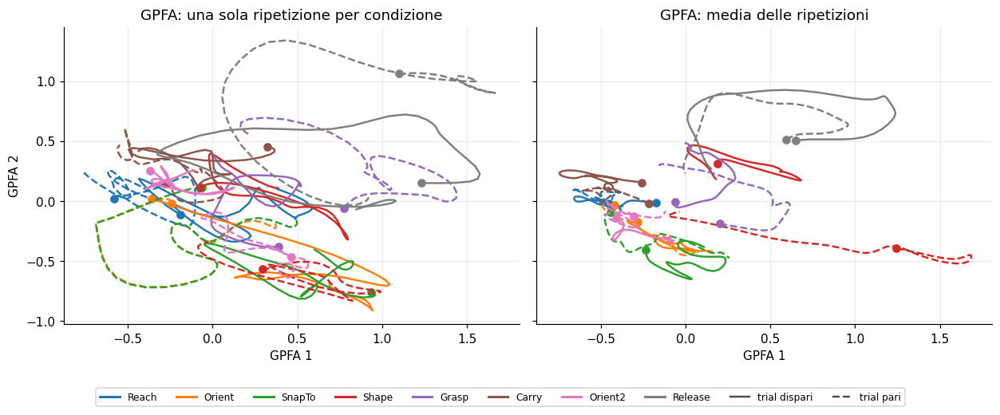 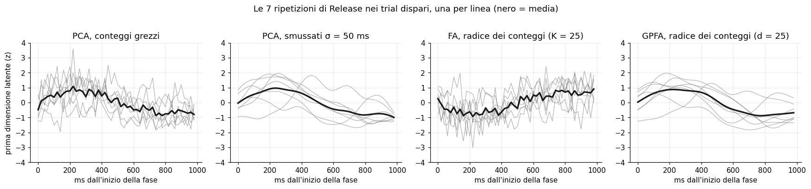 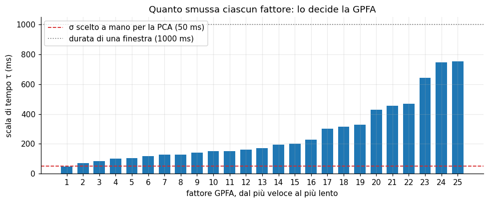 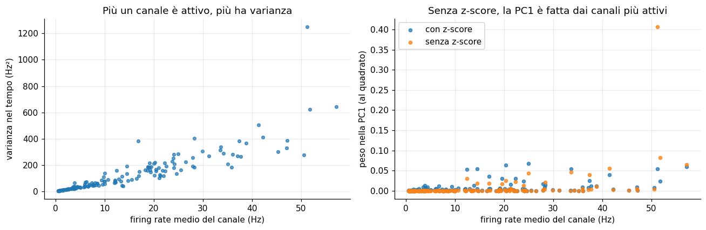 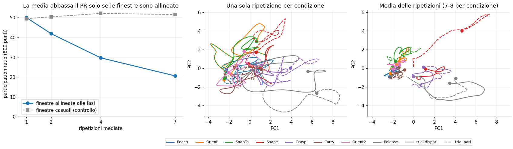 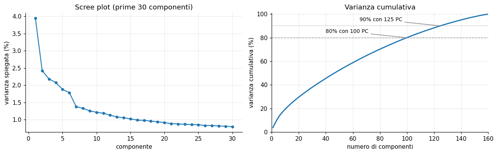 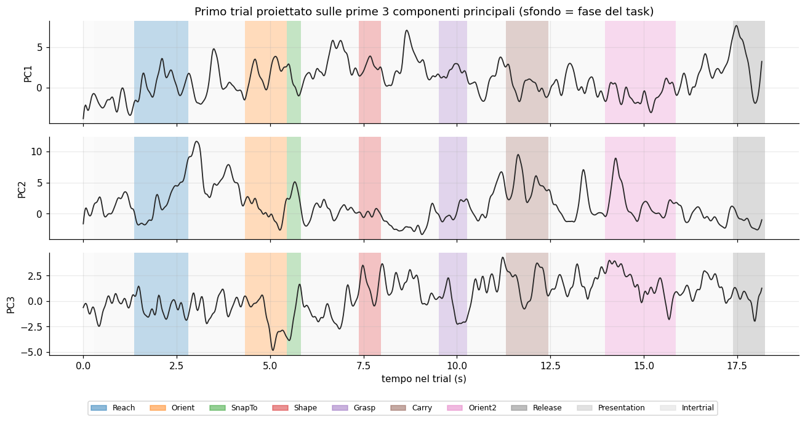 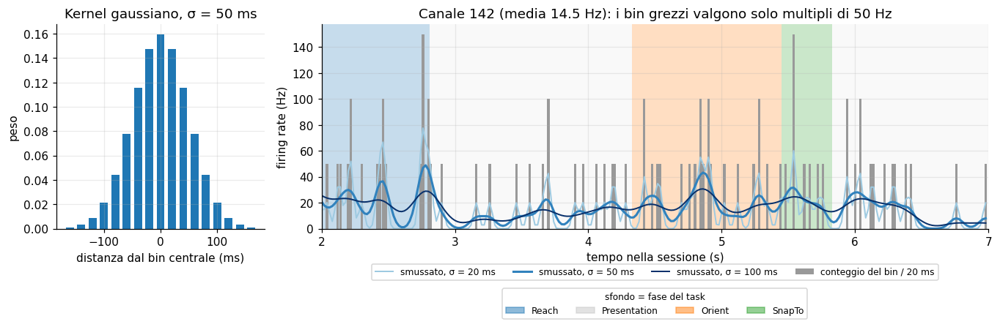 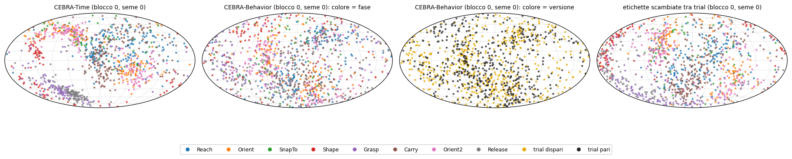 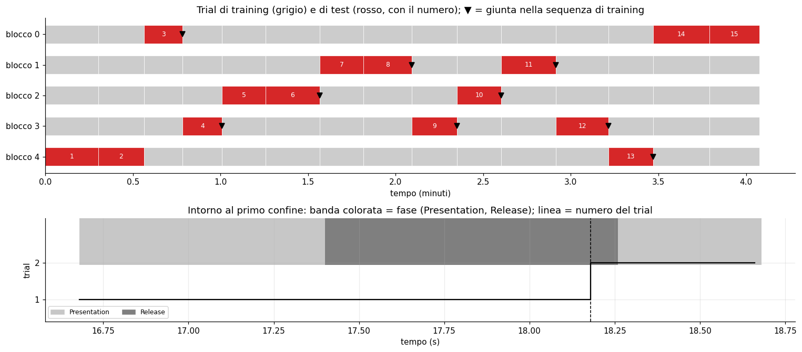 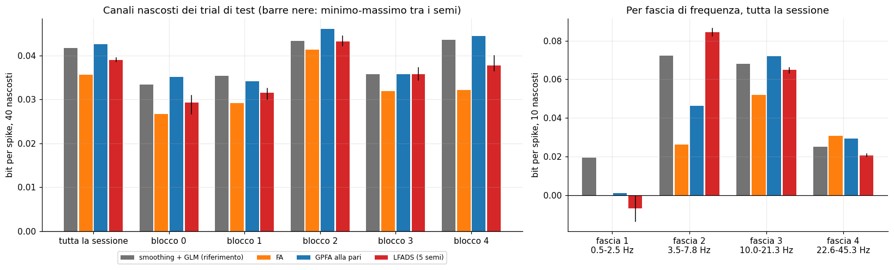 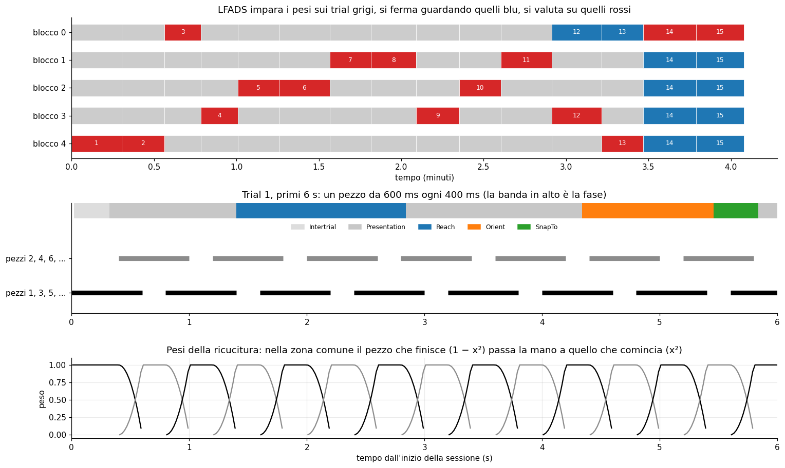 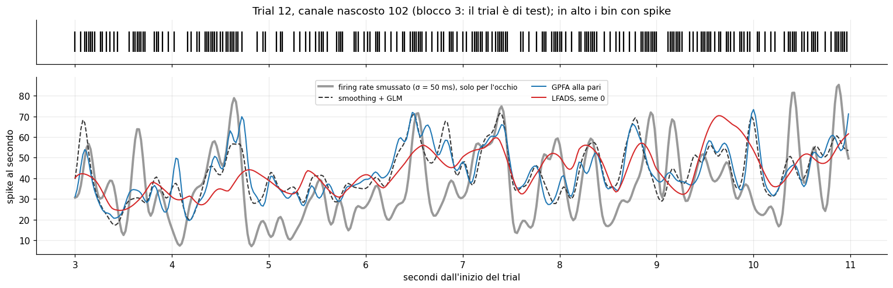 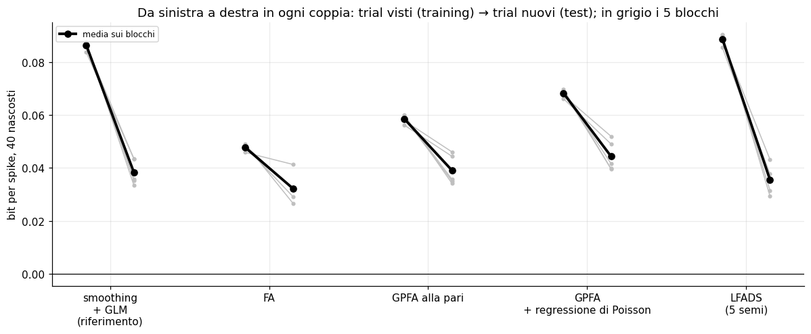 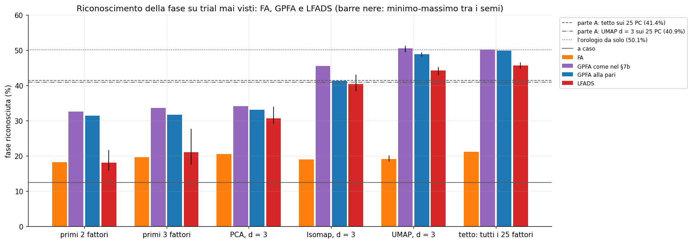 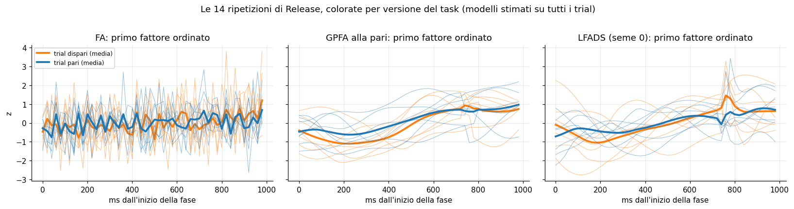 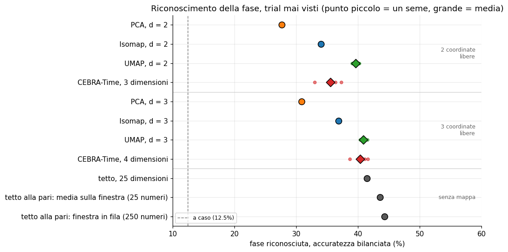 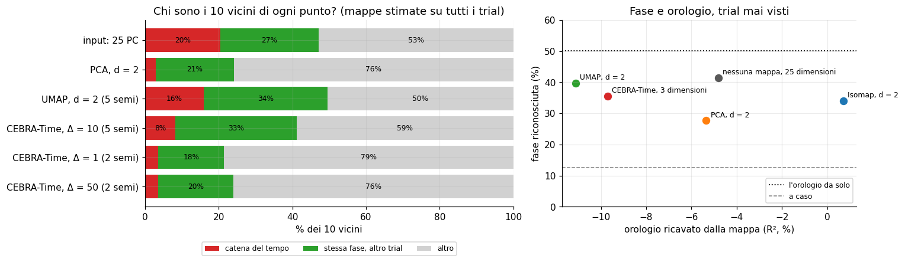 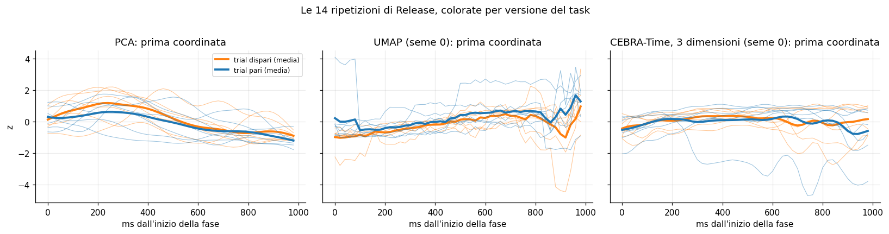 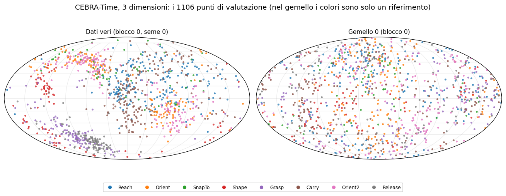 
