# Session 19250113T120811 (S2)

Generated by `rep/tables.py`. FALCON bins.

## Decoder

| condition | mean R² | tx | ty | tz | rx | g1 | g2 | g3 | α |
|---|---|---|---|---|---|---|---|---|---|
| zero-shot (without its own day) | 0.097 | 0.209 | -2.820 | -0.430 | 0.162 | -0.071 | 0.059 | 0.336 | 10^4.5 |
| held-in 80% (day included) | 0.401 | 0.283 | -0.622 | -0.233 | 0.359 | 0.415 | 0.431 | 0.399 | 10^4.5 |
| session only, 80% | 0.344 | 0.247 | -0.368 | -0.292 | 0.269 | 0.446 | 0.366 | 0.270 | 10^4.5 |

## Dimensionality and subspaces (02)

**Data**

| measure | S2 |
|---|---|
| active channels (≥ 0.5 Hz) | 166 |
| mean rate (Hz) | 14.7 |

**PCA (σ = 50 ms, all bins)**

| measure | S2 |
|---|---|
| participation ratio | 104.0 |
| variance of PC1 (%) | 4.1 |
| variance of PC1-3 (%) | 9.5 |
| components for 80% / 90% / 95% | 103 / 129 / 145 |

**PCA on condition means**

| measure | S2 |
|---|---|
| participation ratio | 16.1 |
| components for 95% | 78 |
| PR with 1 / 7 repetitions averaged (aligned windows) | 47.6 / 16.9 |

**FA (counts, K* = 15)**

| measure | S2 |
|---|---|
| PR of the shared part | 9.4 |
| shared dimensions for 95% | 14 |
| first 3 directions (% of shared variance) | 47 |
| shared fraction per channel, median | 0.034 |

**FA in windows (K* = 10)**

| measure | S2 |
|---|---|
| PR of the shared part | 6.6 |

**GPFA (d = 25)**

| measure | S2 |
|---|---|
| PR of the shared part | 10.5 |
| shared dimensions for 95% | 21 |
| shared fraction per channel, median (%) | 3.8 |
| shortest / longest timescale (ms) | 61.0 / 1125.0 |

**Trajectories in windows**

| measure | S2 |
|---|---|
| consistency: smoothed PCA | 0.1422 |
| consistency: FA (K = 25) | 0.0448 |
| consistency: GPFA (d = 25) | 0.1542 |
| roughness: GPFA (d = 25) | 0.0044 |

## CEBRA, LFADS, GPFA (04)

**Data**

| measure | S2 |
|---|---|
| evaluation points | 1037 |

**Decoded phase (%), chance 12.5**

| measure | S2 |
|---|---|
| PCA, d = 3 | 37.8 |
| CEBRA-Time, 3 dimensions | 40.5 (37.7-42.4) |
| CEBRA-Time, 4 dimensions | 44.0 (41.0-46.9) |
| ceiling: 25 smoothed PCs | 46.7 |
| matched ceiling: window mean | 48.0 |
| clock (only the time since trial start) | 47.2 |
| CEBRA-Time 3D on the twins | 12.8 (11.6-14.1) |

**CEBRA-Time**

| measure | S2 |
|---|---|
| consistency across training runs, 3D (R², %) | 65.3 (53.7-84.9) |
| consistency across training runs, 4D (R², %) | 68.0 (58.4-79.3) |
| neighbors in the time chain, Δ = 10 (%) | 8.1 |
| same-phase neighbors in other trials, Δ = 10 (%) | 35.7 |
| roughness, 4D | 0.072 (0.059-0.077) |
| trajectory consistency, 4D | 0.113 (0.090-0.128) |

**§12: phase, ceiling with all 25 factors (%)**

| measure | S2 |
|---|---|
| FA | 28.0 |
| GPFA as in §7b | 53.2 |
| matched GPFA | 54.4 |
| LFADS (5 seeds) | 52.3 (50.5-53.0) |
| 25 smoothed PCs (part A) | 46.7 |

**§12: phase, first 3 factors (%)**

| measure | S2 |
|---|---|
| FA | 22.0 |
| matched GPFA | 37.9 |
| LFADS (5 seeds) | 25.1 (21.8-28.3) |
| 25 smoothed PCs (part A) | 37.8 |

**§12: phase without SnapTo, ceiling (%), chance 14.3**

| measure | S2 |
|---|---|
| matched GPFA | 62.3 |
| LFADS (5 seeds) | 59.7 (58.2-60.6) |

**§12: bits/spike on the 40 hidden channels, new trials**

| measure | S2 |
|---|---|
| smoothing + GLM (reference) | 0.0247 |
| FA | 0.0227 |
| matched GPFA | 0.0294 |
| LFADS (5 seeds) | 0.0292 [0.0280, 0.0305] |
| GPFA + Poisson regression | 0.0339 |
| LFADS above smoothing + GLM (block × seed) | 25 of 25 |

**§13: bits/spike, new trials / seen trials**

| measure | S2 |
|---|---|
| smoothing + GLM | 0.3051 |
| matched GPFA | 0.5831 |
| LFADS (5 seeds) | 0.3557 [0.3290, 0.3707] |

**§13: bits/spike with hidden channels shifted in time (new trials)**

| measure | S2 |
|---|---|
| smoothing + GLM | -0.0230 |
| matched GPFA | -0.0145 |
| LFADS (3 seeds) | -0.0138 [-0.0148, -0.0132] |

**§13: twins**

| measure | S2 |
|---|---|
| LFADS on the twin, phase with all factors (%) | 12.9 (11.1-14.2) |

**§12: stability**

| measure | S2 |
|---|---|
| LFADS across seeds, 25 factors (R², %) | 89.7 (88.2-91.1) |
| trajectory consistency: matched GPFA | 0.157 |
| trajectory consistency: LFADS | 0.086 (0.051-0.122) |

## Principal angles (mean angle, degrees)

Subspaces estimated on all bins; chance cases: median and 5th percentile of the mean angle over 500 pairs (see comparison.md, §4).

| method | comparison | observed | chance, all bins: median (5th) | below 5th (chance, all bins) | chance, condition means: median (5th) | below 5th (chance, condition means) | uniform: median (5th) | below 5th (uniform) |
|---|---|---|---|---|---|---|---|---|
| PCA, K = 10 | ref. S1 – S2 | 46.5 | 75.7 (73.9) | yes | 67.9 (65.3) | yes | 77.5 (76.0) | yes |
| PCA, K = 10 | S2 – S5 | 46.9 | 75.5 (73.5) | yes | 68.2 (65.7) | yes | 77.5 (76.0) | yes |
| PCA, K = 10 | half – half S2 | 41.0 | 75.1 (73.1) | yes | 64.6 (61.9) | yes | 77.5 (76.0) | yes |
| PCA, K = 25 | ref. S1 – S2 | 51.9 | 67.2 (66.1) | yes | 59.1 (57.8) | yes | 69.3 (68.4) | yes |
| PCA, K = 25 | S2 – S5 | 53.2 | 66.9 (65.8) | yes | 59.3 (57.9) | yes | 69.3 (68.4) | yes |
| PCA, K = 25 | half – half S2 | 49.9 | 66.5 (65.4) | yes | 54.7 (53.2) | yes | 69.3 (68.4) | yes |
| FA, K = 10 | ref. S1 – S2 | 36.4 | 77.3 (75.6) | yes | 75.4 (73.5) | yes | 77.5 (76.0) | yes |
| FA, K = 10 | S2 – S5 | 40.0 | 77.3 (75.6) | yes | 75.4 (73.5) | yes | 77.5 (76.0) | yes |
| FA, K = 10 | half – half S2 | 34.4 | 77.2 (75.5) | yes | 74.6 (72.5) | yes | 77.5 (76.0) | yes |
| FA, K = 15 | ref. S1 – S2 | 42.8 | 74.1 (72.8) | yes | 72.1 (70.7) | yes | 74.4 (73.2) | yes |
| FA, K = 15 | S2 – S5 | 45.3 | 74.1 (72.8) | yes | 72.2 (70.7) | yes | 74.4 (73.2) | yes |
| FA, K = 15 | half – half S2 | 41.6 | 74.0 (72.7) | yes | 71.3 (69.8) | yes | 74.4 (73.2) | yes |
| FA, K = 25 | ref. S1 – S2 | 46.8 | 69.0 (68.0) | yes | 67.1 (66.0) | yes | 69.3 (68.4) | yes |
| FA, K = 25 | S2 – S5 | 47.2 | 69.0 (68.0) | yes | 67.2 (66.1) | yes | 69.3 (68.4) | yes |
| FA, K = 25 | half – half S2 | 48.1 | 68.9 (67.9) | yes | 66.1 (65.0) | yes | 69.3 (68.4) | yes |
| GPFA, K = 10 | ref. S1 – S2 | 49.8 | 74.9 (73.0) | yes | 73.0 (70.8) | yes | 77.5 (76.0) | yes |
| GPFA, K = 10 | S2 – S5 | 50.0 | 74.9 (72.9) | yes | 73.0 (70.9) | yes | 77.5 (76.0) | yes |
| GPFA, K = 10 | half – half S2 | 42.7 | 74.6 (72.5) | yes | 72.0 (69.8) | yes | 77.5 (76.0) | yes |
| GPFA, K = 25 | ref. S1 – S2 | 48.4 | 65.4 (64.2) | yes | 63.7 (62.5) | yes | 69.3 (68.4) | yes |
| GPFA, K = 25 | S2 – S5 | 49.8 | 65.3 (64.1) | yes | 63.6 (62.4) | yes | 69.3 (68.4) | yes |
| GPFA, K = 25 | half – half S2 | 47.6 | 64.8 (63.6) | yes | 62.5 (61.3) | yes | 69.3 (68.4) | yes |

## Figures

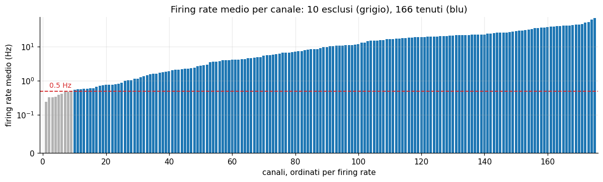 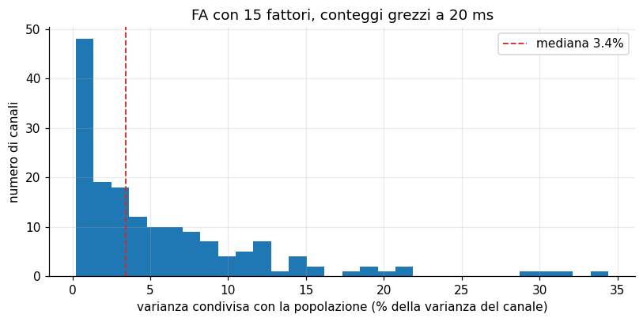 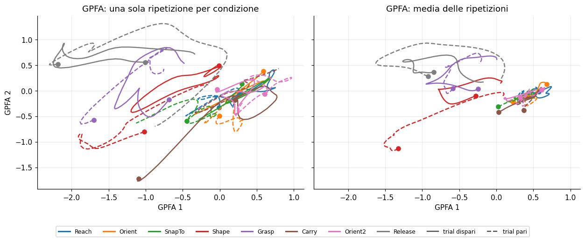 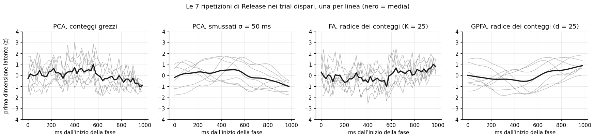 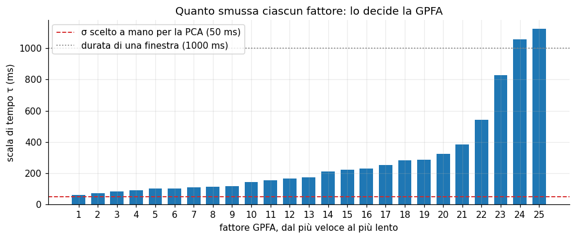 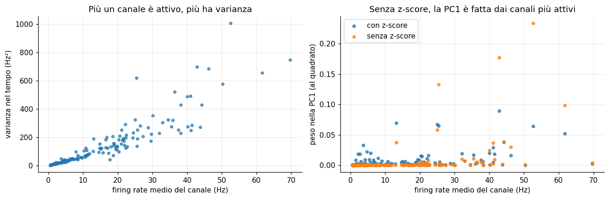 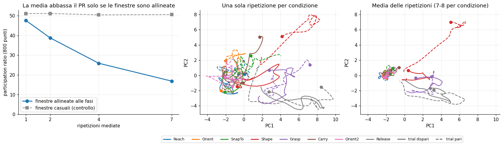 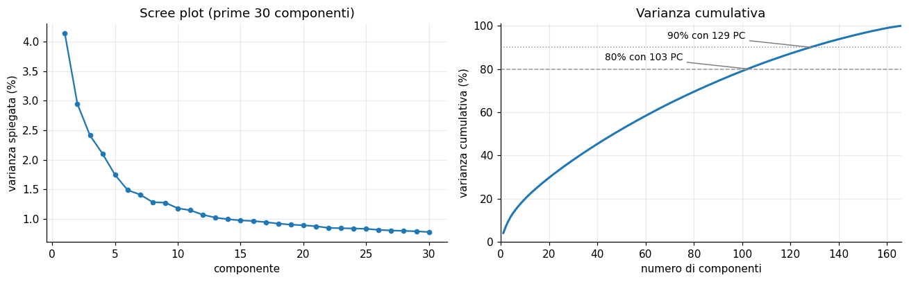 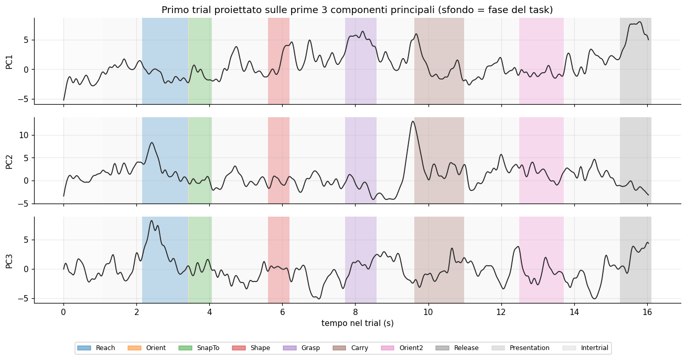 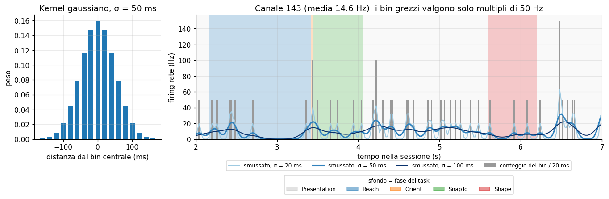 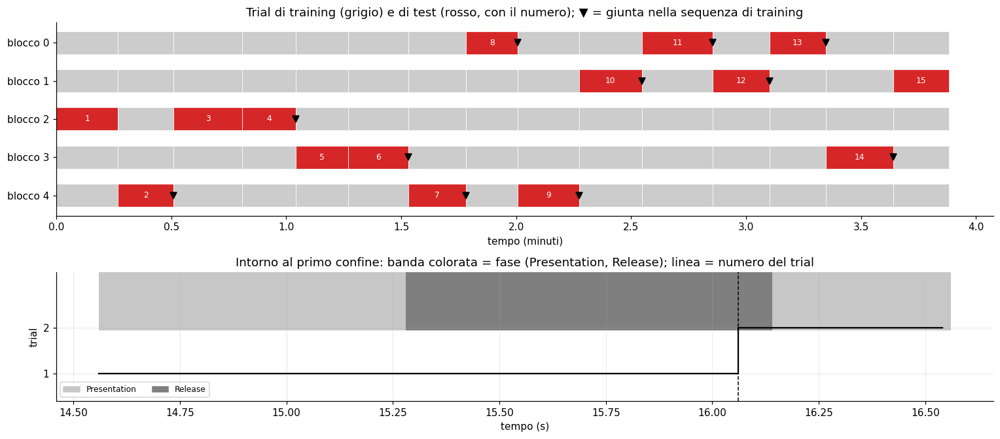 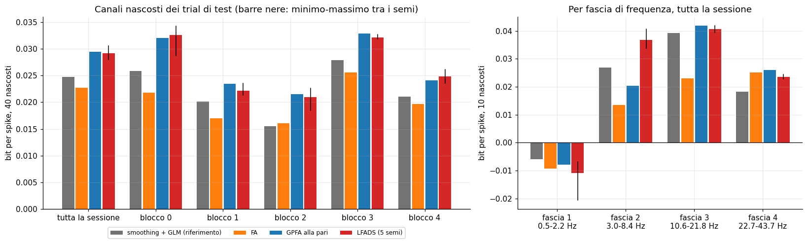 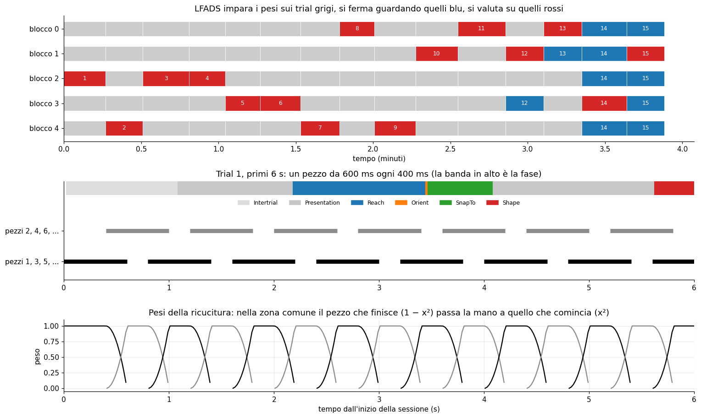 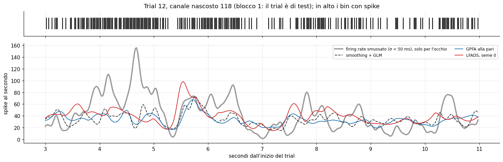 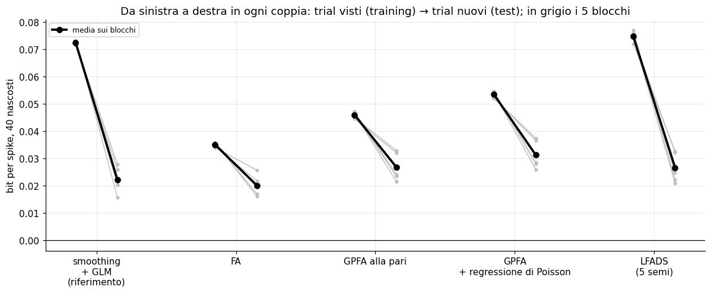 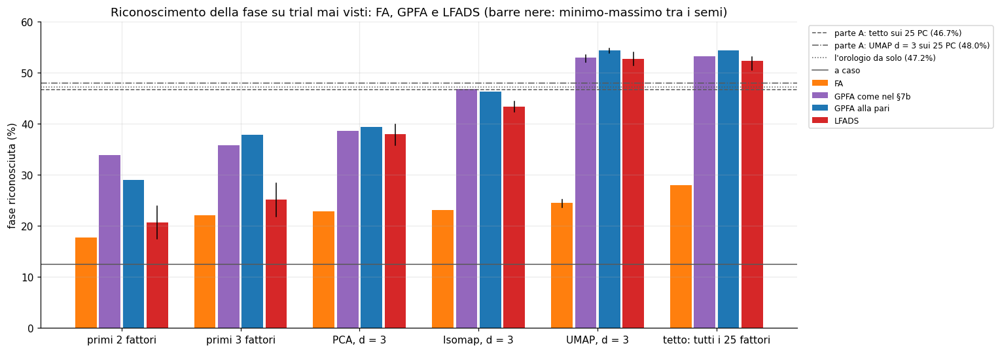 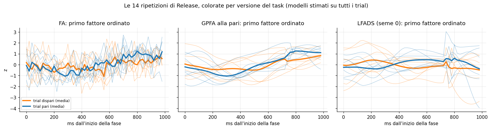 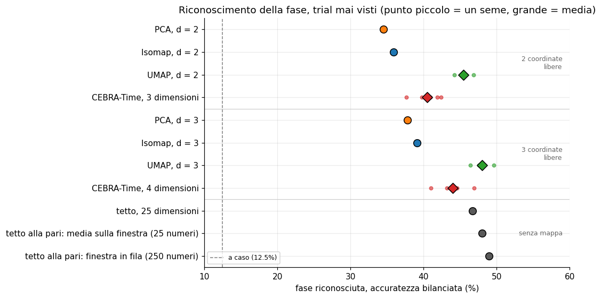 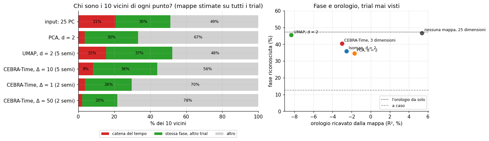 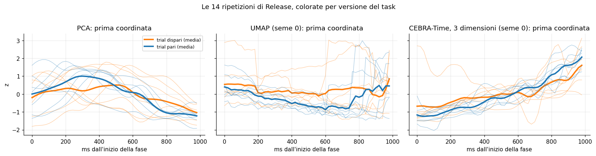 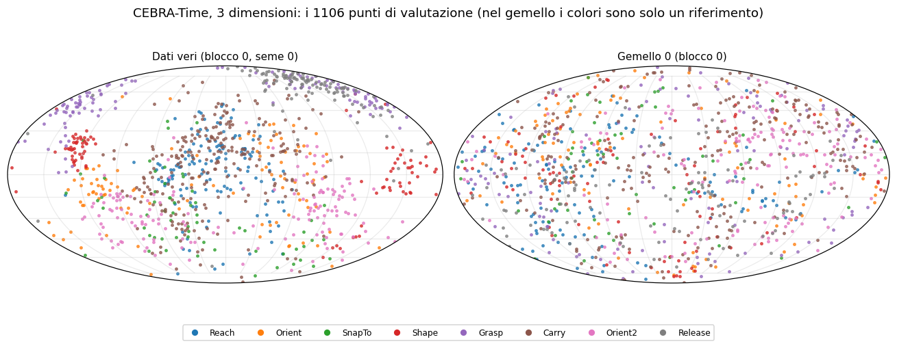 
