# Session 19250120T115044 (S5)

Generated by `rep/tables.py`. FALCON bins.

## Decoder

| condition | mean R² | tx | ty | tz | rx | g1 | g2 | g3 | α |
|---|---|---|---|---|---|---|---|---|---|
| zero-shot (without its own day) | 0.192 | 0.237 | -1.059 | -0.309 | 0.462 | 0.329 | 0.344 | -0.281 | 10^4.5 |
| held-in 80% (day included) | 0.452 | 0.392 | 0.331 | 0.349 | 0.543 | 0.423 | 0.445 | 0.441 | 10^4.5 |
| session only, 80% | 0.338 | 0.374 | 0.288 | 0.186 | 0.409 | 0.376 | 0.292 | 0.319 | 10^4.5 |

## Dimensionality and subspaces (02)

**Data**

| measure | S5 |
|---|---|
| active channels (≥ 0.5 Hz) | 165 |
| mean rate (Hz) | 16.8 |

**PCA (σ = 50 ms, all bins)**

| measure | S5 |
|---|---|
| participation ratio | 94.4 |
| variance of PC1 (%) | 4.8 |
| variance of PC1-3 (%) | 11.0 |
| components for 80% / 90% / 95% | 100 / 126 / 143 |

**PCA on condition means**

| measure | S5 |
|---|---|
| participation ratio | 21.6 |
| components for 95% | 79 |
| PR with 1 / 7 repetitions averaged (aligned windows) | 48.5 / 22.6 |

**FA (counts, K* = 15)**

| measure | S5 |
|---|---|
| PR of the shared part | 9.1 |
| shared dimensions for 95% | 14 |
| first 3 directions (% of shared variance) | 48 |
| shared fraction per channel, median | 0.032 |

**FA in windows (K* = 10)**

| measure | S5 |
|---|---|
| PR of the shared part | 6.9 |

**GPFA (d = 25)**

| measure | S5 |
|---|---|
| PR of the shared part | 11.6 |
| shared dimensions for 95% | 21 |
| shared fraction per channel, median (%) | 3.9 |
| shortest / longest timescale (ms) | 51.0 / 1268.0 |

**Trajectories in windows**

| measure | S5 |
|---|---|
| consistency: smoothed PCA | 0.1533 |
| consistency: FA (K = 25) | 0.0577 |
| consistency: GPFA (d = 25) | 0.1549 |
| roughness: GPFA (d = 25) | 0.0049 |

## CEBRA, LFADS, GPFA (04)

**Data**

| measure | S5 |
|---|---|
| evaluation points | 1137 |

**Decoded phase (%), chance 12.5**

| measure | S5 |
|---|---|
| PCA, d = 3 | 28.3 |
| CEBRA-Time, 3 dimensions | 31.2 (29.6-33.0) |
| CEBRA-Time, 4 dimensions | 34.9 (33.3-37.0) |
| ceiling: 25 smoothed PCs | 36.9 |
| matched ceiling: window mean | 39.7 |
| clock (only the time since trial start) | 63.8 |
| CEBRA-Time 3D on the twins | 14.1 (12.7-16.3) |

**CEBRA-Time**

| measure | S5 |
|---|---|
| consistency across training runs, 3D (R², %) | 64.5 (51.3-81.5) |
| consistency across training runs, 4D (R², %) | 75.2 (64.6-85.2) |
| neighbors in the time chain, Δ = 10 (%) | 8.4 |
| same-phase neighbors in other trials, Δ = 10 (%) | 25.1 |
| roughness, 4D | 0.077 (0.072-0.084) |
| trajectory consistency, 4D | 0.091 (0.086-0.097) |

**§12: phase, ceiling with all 25 factors (%)**

| measure | S5 |
|---|---|
| FA | 22.4 |
| GPFA as in §7b | 42.6 |
| matched GPFA | 42.6 |
| LFADS (5 seeds) | 42.5 (39.7-45.2) |
| 25 smoothed PCs (part A) | 36.9 |

**§12: phase, first 3 factors (%)**

| measure | S5 |
|---|---|
| FA | 19.8 |
| matched GPFA | 26.2 |
| LFADS (5 seeds) | 19.6 (15.8-23.9) |
| 25 smoothed PCs (part A) | 28.3 |

**§12: phase without SnapTo, ceiling (%), chance 14.3**

| measure | S5 |
|---|---|
| matched GPFA | 49.0 |
| LFADS (5 seeds) | 47.5 (45.3-50.8) |

**§12: bits/spike on the 40 hidden channels, new trials**

| measure | S5 |
|---|---|
| smoothing + GLM (reference) | 0.0563 |
| FA | 0.0368 |
| matched GPFA | 0.0602 |
| LFADS (5 seeds) | 0.0575 [0.0572, 0.0579] |
| GPFA + Poisson regression | 0.0642 |
| LFADS above smoothing + GLM (block × seed) | 20 of 25 |

**§13: bits/spike, new trials / seen trials**

| measure | S5 |
|---|---|
| smoothing + GLM | 0.5301 |
| matched GPFA | 0.7424 |
| LFADS (5 seeds) | 0.5214 [0.5167, 0.5260] |

**§13: bits/spike with hidden channels shifted in time (new trials)**

| measure | S5 |
|---|---|
| smoothing + GLM | -0.0229 |
| matched GPFA | -0.0199 |
| LFADS (3 seeds) | -0.0169 [-0.0171, -0.0166] |

**§13: twins**

| measure | S5 |
|---|---|
| LFADS on the twin, phase with all factors (%) | 13.3 (10.9-15.8) |

**§12: stability**

| measure | S5 |
|---|---|
| LFADS across seeds, 25 factors (R², %) | 90.3 (89.1-91.5) |
| trajectory consistency: matched GPFA | 0.153 |
| trajectory consistency: LFADS | 0.091 (0.056-0.132) |

## Principal angles (mean angle, degrees)

Subspaces estimated on all bins; chance cases: median and 5th percentile of the mean angle over 500 pairs (see comparison.md, §4).

| method | comparison | observed | chance, all bins: median (5th) | below 5th (chance, all bins) | chance, condition means: median (5th) | below 5th (chance, condition means) | uniform: median (5th) | below 5th (uniform) |
|---|---|---|---|---|---|---|---|---|
| PCA, K = 10 | ref. S1 – S5 | 50.7 | 75.6 (73.7) | yes | 68.4 (66.0) | yes | 77.5 (76.0) | yes |
| PCA, K = 10 | S2 – S5 | 46.9 | 75.5 (73.5) | yes | 68.2 (65.7) | yes | 77.5 (76.0) | yes |
| PCA, K = 10 | half – half S5 | 37.3 | 74.7 (72.7) | yes | 65.6 (63.0) | yes | 77.5 (76.0) | yes |
| PCA, K = 25 | ref. S1 – S5 | 55.5 | 67.1 (66.0) | yes | 59.4 (58.0) | yes | 69.3 (68.4) | yes |
| PCA, K = 25 | S2 – S5 | 53.2 | 66.9 (65.8) | yes | 59.3 (57.9) | yes | 69.3 (68.4) | yes |
| PCA, K = 25 | half – half S5 | 49.4 | 66.2 (65.0) | yes | 55.0 (53.5) | yes | 69.3 (68.4) | yes |
| FA, K = 10 | ref. S1 – S5 | 38.9 | 77.3 (75.6) | yes | 75.6 (73.7) | yes | 77.5 (76.0) | yes |
| FA, K = 10 | S2 – S5 | 40.0 | 77.3 (75.6) | yes | 75.4 (73.5) | yes | 77.5 (76.0) | yes |
| FA, K = 10 | half – half S5 | 36.8 | 77.2 (75.5) | yes | 74.9 (72.9) | yes | 77.5 (76.0) | yes |
| FA, K = 15 | ref. S1 – S5 | 42.8 | 74.1 (72.8) | yes | 72.3 (70.9) | yes | 74.4 (73.2) | yes |
| FA, K = 15 | S2 – S5 | 45.3 | 74.1 (72.8) | yes | 72.2 (70.7) | yes | 74.4 (73.2) | yes |
| FA, K = 15 | half – half S5 | 39.0 | 74.0 (72.7) | yes | 71.6 (70.1) | yes | 74.4 (73.2) | yes |
| FA, K = 25 | ref. S1 – S5 | 47.8 | 69.0 (68.0) | yes | 67.2 (66.2) | yes | 69.3 (68.4) | yes |
| FA, K = 25 | S2 – S5 | 47.2 | 69.0 (68.0) | yes | 67.2 (66.1) | yes | 69.3 (68.4) | yes |
| FA, K = 25 | half – half S5 | 46.3 | 68.8 (67.8) | yes | 66.3 (65.2) | yes | 69.3 (68.4) | yes |
| GPFA, K = 10 | ref. S1 – S5 | 49.8 | 74.9 (73.0) | yes | 73.2 (71.1) | yes | 77.5 (76.0) | yes |
| GPFA, K = 10 | S2 – S5 | 50.0 | 74.9 (72.9) | yes | 73.0 (70.9) | yes | 77.5 (76.0) | yes |
| GPFA, K = 10 | half – half S5 | 41.8 | 74.6 (72.5) | yes | 72.4 (70.1) | yes | 77.5 (76.0) | yes |
| GPFA, K = 25 | ref. S1 – S5 | 49.7 | 65.4 (64.2) | yes | 63.7 (62.5) | yes | 69.3 (68.4) | yes |
| GPFA, K = 25 | S2 – S5 | 49.8 | 65.3 (64.1) | yes | 63.6 (62.4) | yes | 69.3 (68.4) | yes |
| GPFA, K = 25 | half – half S5 | 46.2 | 64.8 (63.6) | yes | 62.5 (61.3) | yes | 69.3 (68.4) | yes |

## Figures

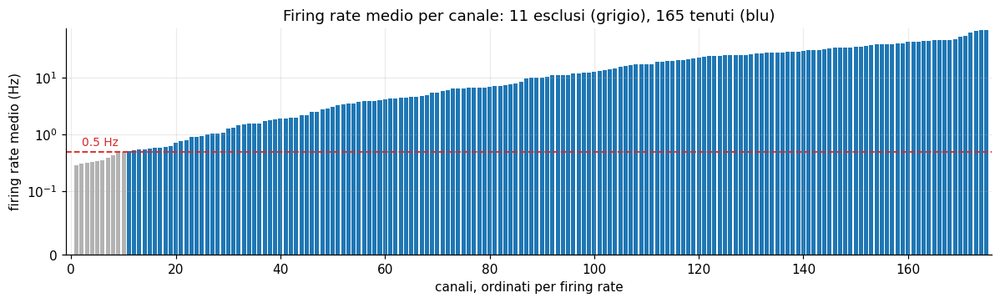 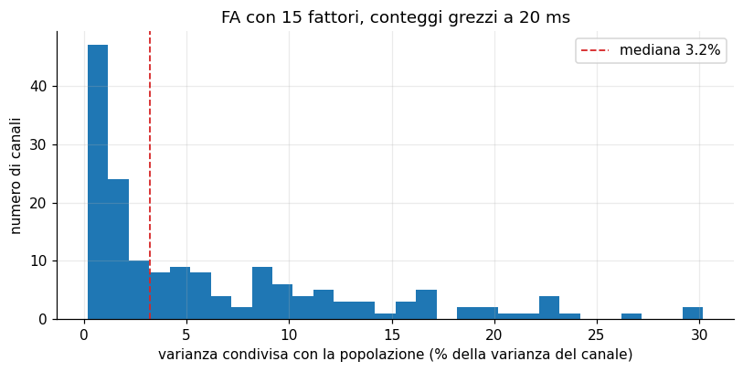 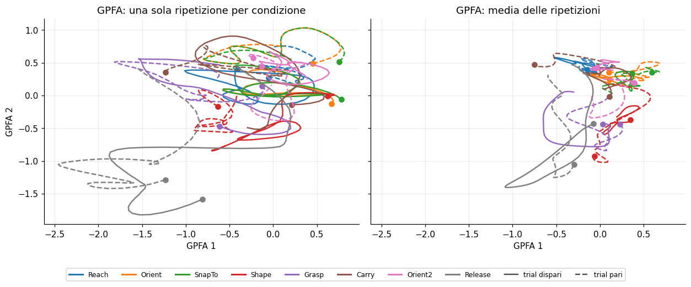 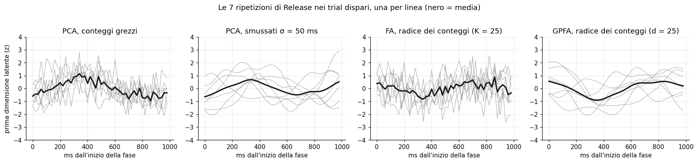 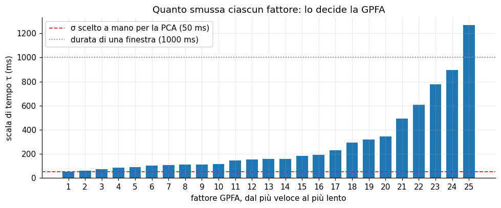 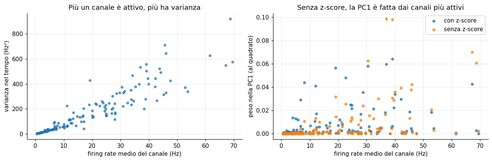 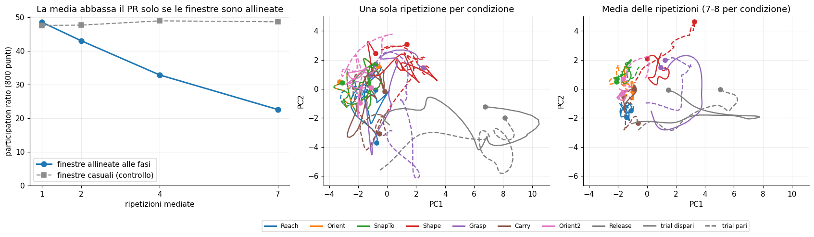 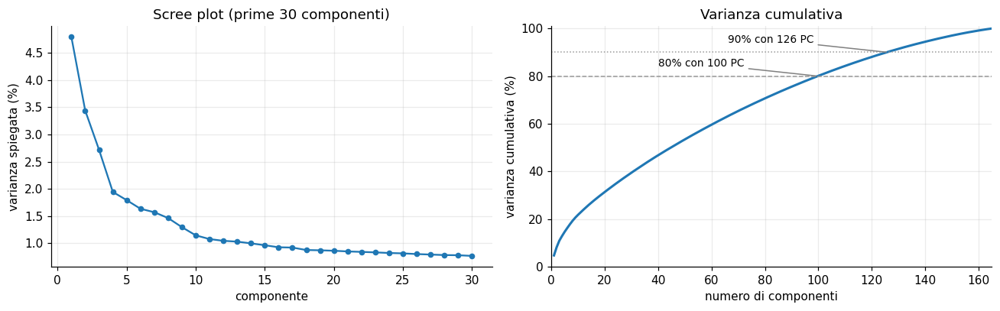 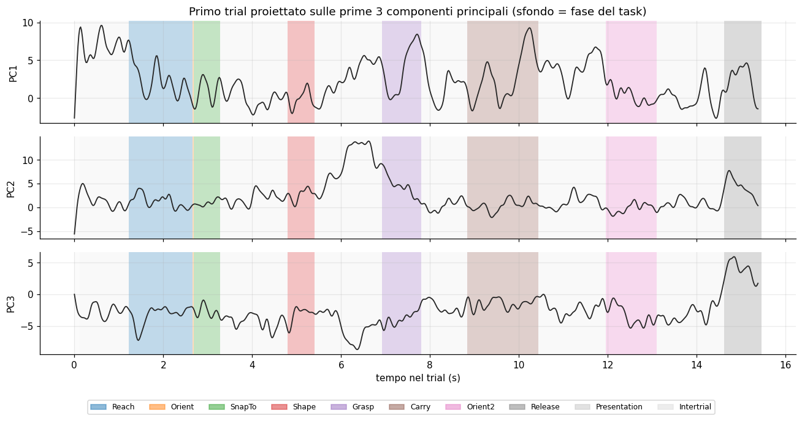 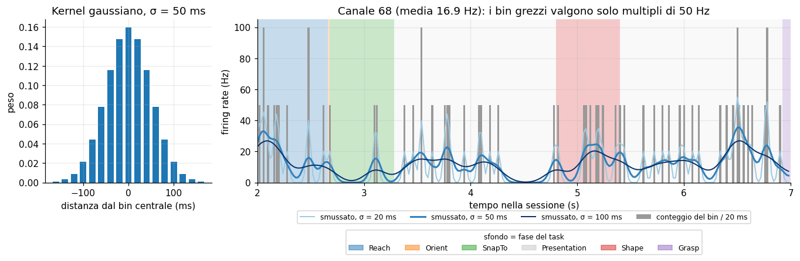 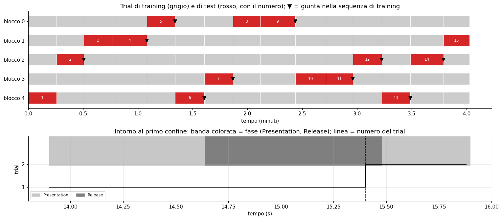 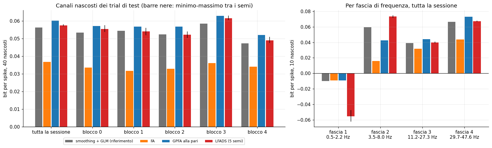 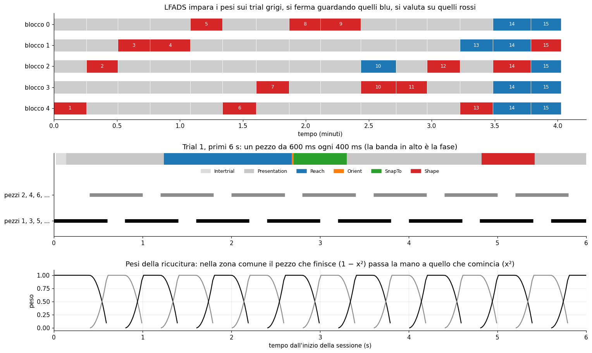 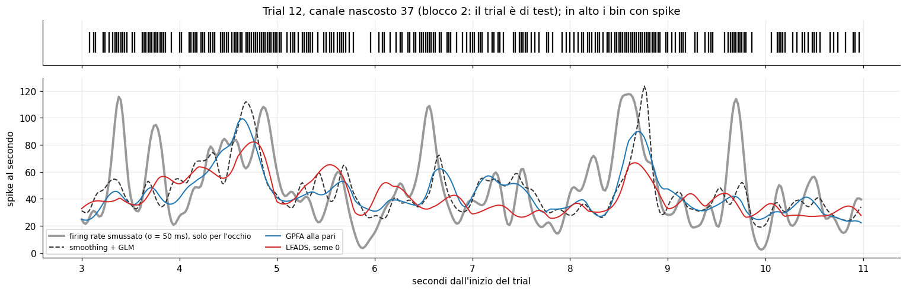 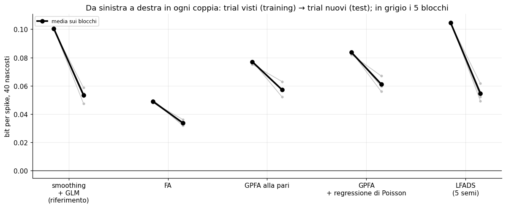 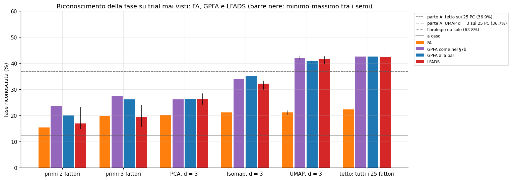 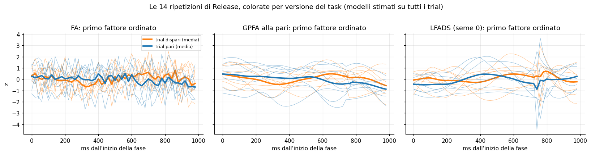 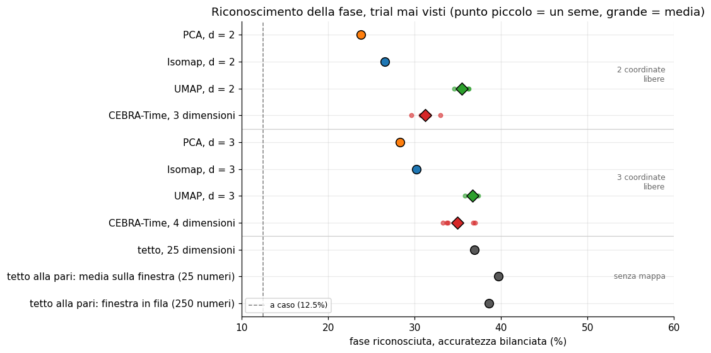 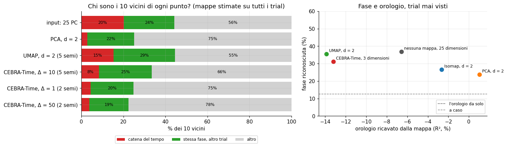 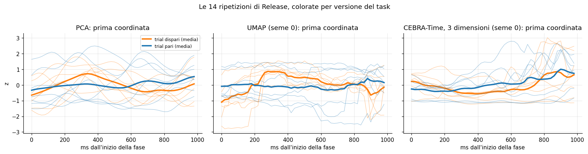 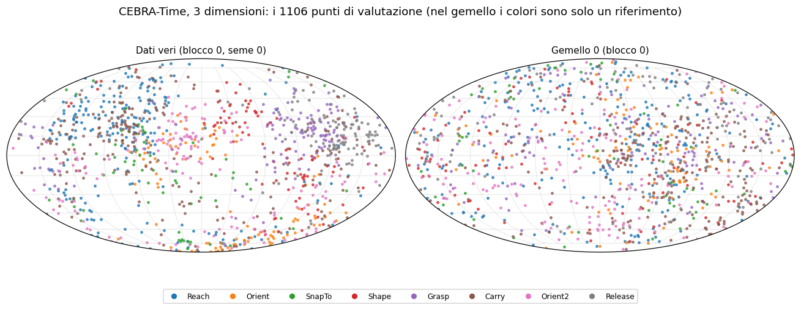 
